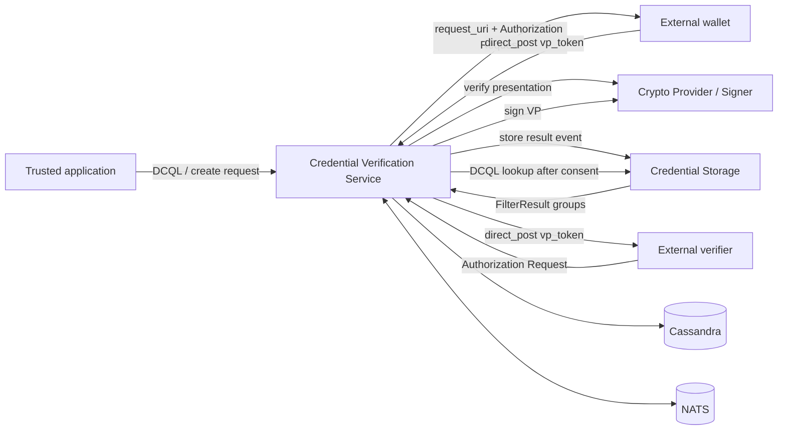
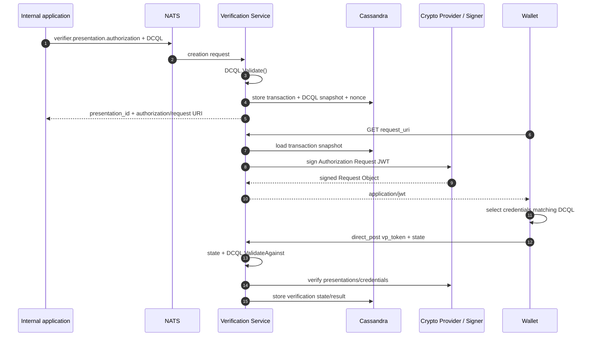
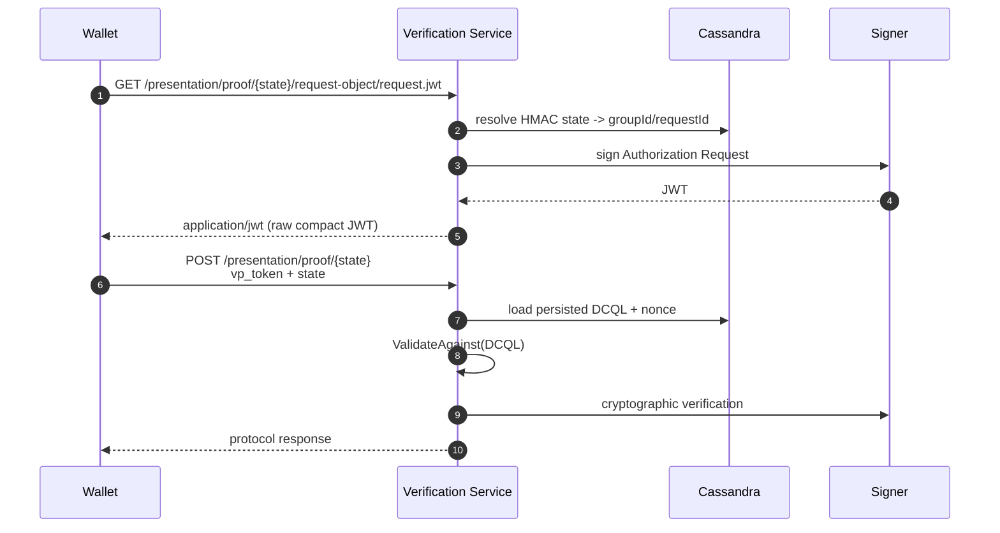
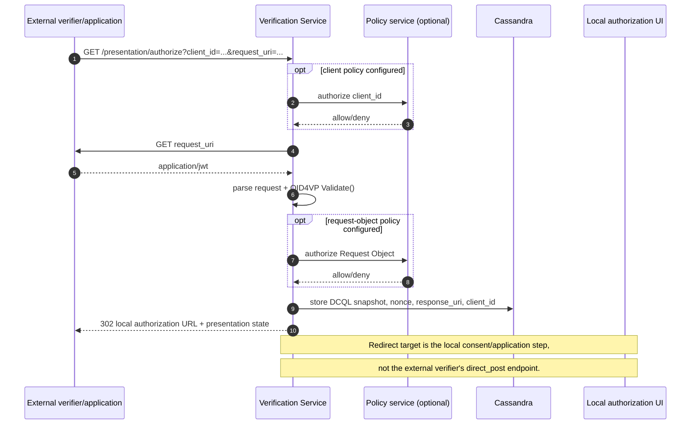
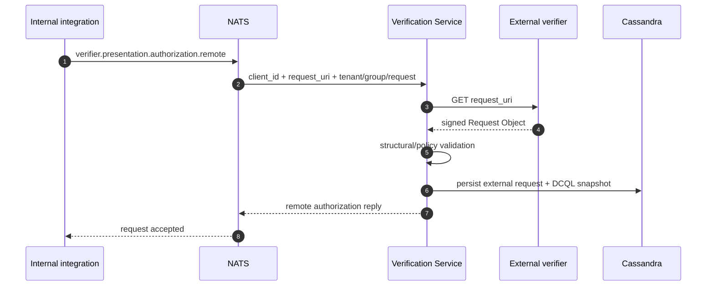
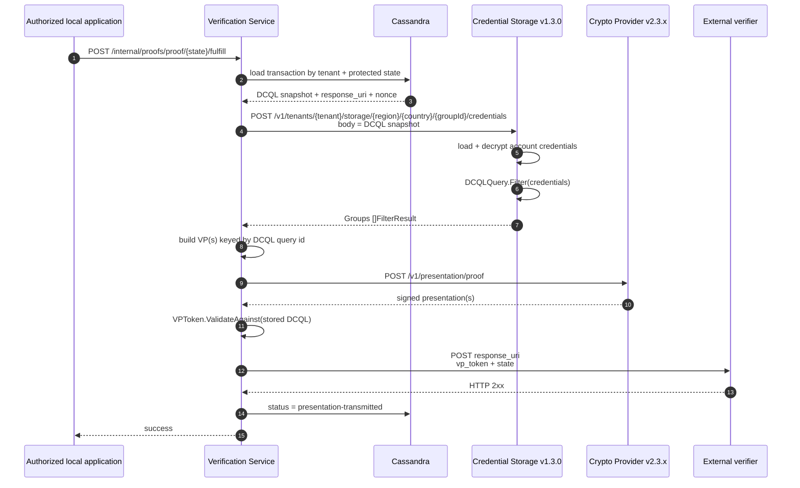
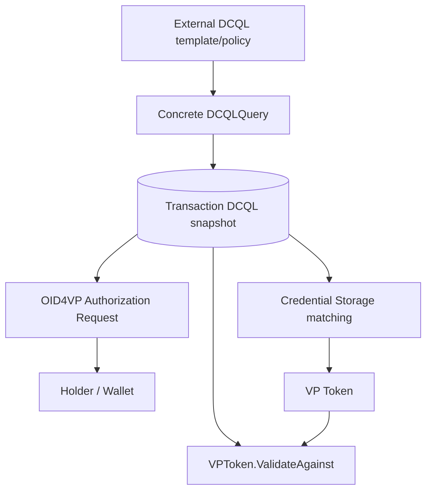
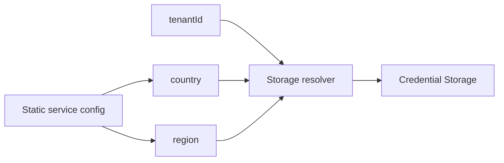
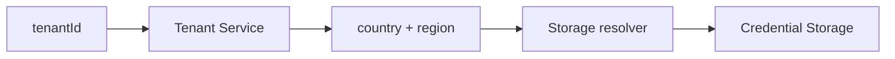
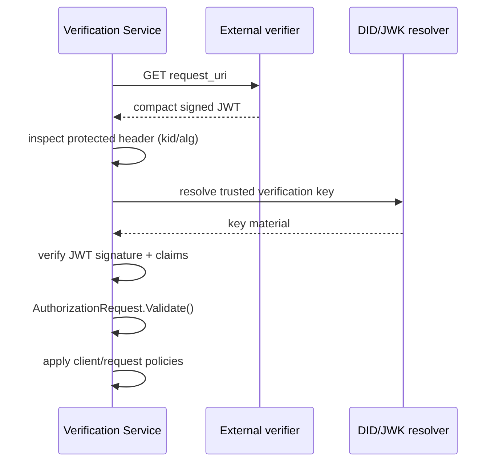

# OID4VC Credential Verification Service

## Security hardening and production configuration (October 2026)

**External Request Objects are authenticated before any request claims are used.** The
External DID-based Request Objects are verified using the `ssi-jwt/v2` DID key resolver. The outer `client_id` must match the signed claim, and `kid` must identify a key of that DID. Non-DID client identifier methods fail closed until supported.

The uploaded Crypto Provider currently offers `/v1/sign`,
`/v1/credential/verify`, `/v1/presentation/verify`, and
`/v1/presentation/proof`; it does **not** expose a general JWS Request Object
verification endpoint. We therefore verify external Request Objects against a
DID-bound SSI-JWT verification instead of incorrectly treating credential verification
as JWT signature verification. If the Signer gains a generic JWS verification
API, this trust adapter can be replaced without changing the flow.

**Network controls:** External `request_uri` and `response_uri` must use HTTPS
outside development. `isDev: true` permits HTTP for local testing. External
URLs cannot point to loopback/private/link-local IP addresses in production,
including after DNS resolution. HTTP 3xx responses are rejected and **never
followed**, including on `direct_post`. All outbound HTTP clients have
10-second timeouts and bounded responses. Internal Storage/Signer/Policy
service URLs may use Kubernetes-internal HTTP, but also reject redirects.

**Do not forward bearer tokens or cookies** from the inbound authorization
request when dereferencing an external `request_uri`.

### Holder fulfillment with consent/selection policy

`externalPresentation.credentialSelectionPolicy` is optional for trusted
headless use. When configured, `/fulfill` sends this JSON request to the
existing Policy Service over HTTP:

```json
{
  "tenantId": "tenant-a",
  "groupId": "account-a",
  "clientId": "decentralized_identifier:did:web:verifier.example",
  "dcqlQuery": {"credentials": [{"id": "identity", "format": "dc+sd-jwt", "meta": {"vct_values": ["urn:example:identity"]}}]},
  "candidates": [{"description": {"id": "identity"}, "credentials": {"credential-key-1": "<credential>"}}]
}
```

Policy Service response:

```json
{
  "allow": true,
  "selection": {
    "identity": ["credential-key-1"]
  }
}
```

`allow: false` denies disclosure. If `allow: true` and `selection` is absent
or empty, all matched candidates are used. If `selection` is provided, only
those query IDs and credential keys are retained; unknown credential keys or
empty selections fail closed. Consent and user interaction happen **before**
`/fulfill`; the service never infers user consent from DCQL matching.

```mermaid
sequenceDiagram
    participant App as Authorized Application / Consent UI
    participant CVS as Verification Service (Holder role)
    participant DB as Cassandra
    participant Storage as Credential Storage
    participant Policy as Policy Service
    participant Signer as Crypto Provider / Signer
    participant V as External Verifier
    App->>CVS: POST /internal/proofs/proof/{state}/fulfill (signing identity)
    CVS->>DB: Load stored external Request Object / DCQL
    CVS->>DB: CAS requested -> fulfilling
    CVS->>Storage: POST DCQL /v1/tenants/{tenant}/storage/{region}/{country}/{account}/credentials
    Storage-->>CVS: FilterResult groups
    CVS->>Policy: tenant, clientId, DCQL, candidates
    Policy-->>CVS: allow + selection per query ID / credential key
    alt denied or no matches
        CVS-->>App: error, no presentation sent
    else allowed
        loop each selected DCQL query
            CVS->>Signer: POST /v1/presentation/proof (format, aud, nonce, credential)
            Signer-->>CVS: signed ldp_vc VP or dc+sd-jwt presentation
        end
        CVS->>CVS: VPToken.ValidateAgainst(persisted DCQL)
        CVS->>V: POST response_uri (vp_token, original external state)
        Note over CVS,V: Redirects forbidden; HTTPS outside dev
        V-->>CVS: HTTP 2xx
        CVS->>DB: status = presentation-transmitted
        CVS-->>App: success
    end
```

### Transaction state and external OID4VP state

`VerificationEntry.State` remains the internal database **status**. The
external verifier's optional OID4VP `state` is stored separately in
`VerificationEntry.AuthorizationState` (Cassandra migration
`V003__add_authorization_state.cql`) and is returned **unchanged** in the
`direct_post` response. An absent external state is not fabricated. The
fulfillment path acquires a Cassandra conditional update
`presentation-requested -> presentation-fulfilling` to reject concurrent
submissions. On failure before transmission it releases the claim; after a
successful network submission it never automatically retries, to avoid
releasing the same credentials twice. A durable outbox would be required for
exactly-once recovery across process crashes.

### Format-specific signing

The Crypto Provider's `/v1/presentation/proof` endpoint is used for both
`ldp_vc` and `dc+sd-jwt`. For SD-JWT the service passes the original compact
SD-JWT, `format: dc+sd-jwt`, stored `nonce`, `aud: clientId`, and holder signing
identity; the Signer creates the key-bound SD-JWT presentation. For LDP VC,
the service constructs a JSON-LD VP and asks the Signer for its proof.
Unsupported formats fail closed. Manual legacy proof submission cannot create
SD-JWT presentations without the persisted transaction audience/nonce.

### Configuration and later Tenant Service

```yaml
isDev: false
country: DE
region: EU
externalPresentation:
  clientIdPolicy: http://policy-service:8080/policy/client
  credentialSelectionPolicy: http://policy-service:8080/policy/credential-selection
```

`country` and `region` deliberately remain **static service settings**. The
Storage adapter consumes these fields when constructing the retrieval path.
A future Tenant Service should resolve them from `tenantId` there; it must not
change DCQL, signer or external Request Object semantics.

### Swagger, Insomnia, Playground

- `docs/swagger.json`, `docs/swagger.yaml`, `docs/docs.go` describe the
  tenant-scoped routes and `/fulfill`.
- `docs/Insomnia_OID4VP_2026.json` replaces the legacy Presentation Exchange
  collection; it includes direct-post, Request Object, authorization, internal
  proof and fulfillment routes.
- Docker playground includes Holder Fulfillment and tenant-qualified URLs;
  its HTTP client does not follow redirects.

**Deployment caution:** A complete Go 1.25 build, signer integration tests,
Cassandra migration test, and an end-to-end test with a trusted external
verifier are still required before production rollout. The existing manual
proof route is retained for compatibility and should be restricted to
privileged internal callers.


The Credential Verification Service implements the verifier-facing and holder-facing OID4VP flows used by the XFSC OCM stack. It supports OID4VP 1.0/DCQL through `oid4-vci-vp-library v1.9.2` and integrates with Credential Storage, Crypto Provider/Signer, Cassandra and NATS.

> **Terminology:** this service uses **DCQL**. `presentation_definition` / Presentation Exchange is legacy terminology and is not part of the current OID4VP flow described here.

## Responsibilities and trust boundaries

The service has two different protocol roles. Keeping them separate is essential:

- **Verifier role (outbound request):** an internal trusted application supplies an already-authorized DCQL query. The service creates a transaction and OID4VP Authorization Request. A wallet selects credentials and sends a `vp_token` back.
- **Holder role (inbound external request):** an external verifier supplies an OID4VP Authorization Request. The service stores its DCQL query as a transaction snapshot. After the local application authorizes disclosure, the service resolves matching credentials from Credential Storage, creates/signs the presentation and sends it to the external verifier's `response_uri`.

DCQL templates and business policy are intentionally **external concerns**. This service consumes a concrete DCQL query and stores the exact query with the transaction.



## Configuration

The service is built with Go 1.25 and currently uses, among others:

- `oid4-vci-vp-library v1.9.2`
- `credential-storage-service v1.3.0`
- `crypto-provider-service/v2 v2.3.7`
- `microservice-core-go v1.1.2`

Important configuration values are:

```yaml
country: DE
region: EU
storageServiceUrl: http://credential-storage-service:8080
signerService:
  presentationSignUrl: http://signer:8080/v1/presentation/proof
  presentationVerifyUrl: http://signer:8080/v1/presentation/verify
```

`country` and `region` are **temporarily static service configuration**. Credential Storage v1.3.0 addresses credentials by tenant, region, country and account. The holder flow isolates this dependency in the Storage resolver. A future Tenant Service should resolve `country` and `region` from `tenantId`; the OID4VP and DCQL flow does not need to change.

The HTTP base URL of Credential Storage is configured with:

```text
CREDENTIALVERIFICATION_STORAGE_URL
```

The NATS storage topic remains separate:

```text
CREDENTIALVERIFICATION_STORAGE_TOPIC
```

`STORAGE_URL` is for credential **retrieval/DCQL matching** over HTTP. `STORAGE_TOPIC` is for storage events.

## Scenario 1 — Internal creation of an OID4VP request (verifier role)

A trusted internal service has already selected/authorized a concrete DCQL query. It requests a presentation through NATS (`verifier.presentation.authorization`). The Verification Service persists the DCQL snapshot and creates an OID4VP request URI.



The wallet-facing `request_uri` does **not** generate or modify DCQL. It serializes the DCQL snapshot already stored for the transaction.

## Scenario 2 — Wallet-facing request_uri and direct_post

The externally visible protocol endpoints are tenant-scoped by `microservice-core-go` under `/v1/tenants/{tenantId}`.



The JWT response is returned as raw `application/jwt`; it is not JSON-quoted.

## Scenario 3 — External Authorization Request through HTTP (holder role)

A permitted external application/verifier can start the holder flow through the authorization endpoint. The service fetches the external `request_uri`, validates the OID4VP request structure and policies, stores the request/DCQL snapshot and redirects to the configured local authorization UI/application.



Headers currently used to bind the local account/transaction are `x-groupId` (storage account), `x-requestId`, and holder signing metadata as required by the surrounding application.

## Scenario 4 — External Authorization Request through NATS

The same inbound request can enter through NATS (`verifier.presentation.authorization.remote`). This is a transport alternative; it is not a different OID4VP protocol.



The actual credential disclosure is a separate fulfillment step. This prevents receipt of an Authorization Request from automatically consenting to credential disclosure.

## Scenario 5 — Fulfill an external request from Credential Storage

After the local application/user has authorized disclosure, call:

```http
POST /v1/tenants/{tenantId}/internal/proofs/proof/{state}/fulfill
Content-Type: application/json
```

Example body:

```json
{
  "holderDid": "did:web:holder.example",
  "signKey": "presentation-key",
  "signNamespace": "tenant-1",
  "signGroup": "account-123"
}
```

Only signing material is accepted. **Credentials are not accepted from the caller.** The service resolves them itself using the stored DCQL snapshot.



### Storage contract

The implementation follows the uploaded Credential Storage Service v1.3.0 DIRECT-mode API:

```text
POST {STORAGE_URL}/v1/tenants/{tenantId}/storage/{region}/{country}/{account}/credentials
Content-Type: application/json
Body: DCQLQuery
```

The Storage Service decrypts the account credentials and evaluates `DCQLQuery.Filter(...)`. The relevant response field is:

```json
{
  "groups": [
    {
      "id": "<dcql credential query id>",
      "credentials": {}
    }
  ]
}
```

In the current Verification Service deployment `groupId` is used as the Storage `account`. This is also the identifier used for the service's account partitioning.

## Manual/legacy proof endpoint

The existing endpoint that accepts `ProofModel.Payload` is retained for compatibility:

```text
POST /v1/tenants/{tenantId}/internal/proofs/proof/{state}
```

New integrations should prefer `/fulfill`, because `/fulfill` derives credentials from the persisted DCQL query and Credential Storage rather than trusting credential groups supplied by the caller.

## State, nonce and DCQL snapshot

Each transaction stores the concrete DCQL query. This is intentional: template/policy configuration can change while a transaction is active, but the eventual `vp_token` must be checked against the exact request the holder received.



The route state is HMAC protected and resolves to `groupId + requestId`. The nonce is persisted with the transaction and used for presentation verification.

## Country/region and future Tenant Service

Today:



Later, only this part should change:



Do not move DCQL templates into this Tenant Service implicitly. DCQL management remains an external policy/template concern unless that architecture is changed explicitly.

## Security: external Request Object verification

The inbound external flow currently parses the compact JWT in order to obtain the OID4VP request claims and then applies OID4VP structural validation and configured policies. **Cryptographic Request Object signature verification against trusted client key material is still a required production hardening step.** Parsing a JWT with `ParseUnverified` is not proof of authenticity and no claim obtained from that parsing should be treated as authenticated solely because parsing succeeded.

The intended final sequence is:



Until that resolver/verification path is implemented, deployments must not treat arbitrary Internet `request_uri` values as authenticated request objects merely because their JWT can be decoded.

## Dependency interaction summary

| Dependency | Purpose |
|---|---|
| Cassandra | transaction state, nonce, DCQL snapshot and received/sent presentation state |
| Credential Storage Service | credential retrieval and DCQL matching for holder-side fulfillment; presentation/result storage events |
| Crypto Provider / Signer | sign generated presentations and verify received presentations/credentials; sign verifier Request Objects through the signer messaging flow |
| NATS | internal request creation, inbound integration and notifications |
| External policy endpoint | optional client/request authorization |
| Future Tenant Service | resolve tenant-dependent country/region (planned, not currently required) |

## Build and validation

The module declares Go 1.25.0. Run in an environment with Go 1.25 available:

```bash
go test ./...
go vet ./...
```

For an end-to-end holder test, run Credential Storage in **DIRECT** mode, seed credentials for the same tenant/region/country/account (`groupId`), submit an external Authorization Request containing DCQL, authorize it locally, then invoke `/fulfill` and verify that the external verifier receives `vp_token` via `direct_post`.

**Known limitation:** Only DID-based external verifier identities are supported. Other OID4VP client identifier methods require their own resolvers. HTTP `authUrl` overrides are permitted only in dev mode.


## External Request Object verification (DID profile)

The holder resolves `request_uri` without redirects and passes the **outer** `client_id` into the verifier. The compact JWS header and payload are decoded as **untrusted** input only to select a DID verification method. The `kid` must refer to that same DID, and embedded/remote attacker-selected key sources (`jwk`, `jku`, `x5u`) are rejected. `ssi-jwt/v2.Parse` resolves the DID key and verifies the signature. The verified `client_id` must equal the outer `client_id`; `iss`, when present, must also match. Only after verification does OID4VP request validation and the policy/consent path run.

**Scope:** This implementation supports DID-based verifier identities only. X.509, verifier attestation and other client identifier methods require separate resolvers and currently fail closed. A DID signature proves key control, not that a verifier is authorized to receive credentials; policy must still decide. DID resolution must be restricted to trusted resolver methods and egress rules in production.

## `direct_post` and `direct_post.jwt`

The Holder flow treats presentation format and Authorization Response mode as independent protocol dimensions.

| DCQL credential format | `direct_post` | `direct_post.jwt` |
| --- | --- | --- |
| `dc+sd-jwt` | supported | supported |
| `ldp_vc` | supported | supported |

For `direct_post`, the service posts `vp_token` and the external `state` as `application/x-www-form-urlencoded` fields.

For `direct_post.jwt`, the service builds the same OID4VP `AuthorizationResponse`, encrypts it as a compact JWE, and posts it in the single `response` form field. The current response encryptor supports Verifier metadata containing an `ECDH-ES` / `P-256` encryption JWK and selects `A128GCM` (preferred/default) or `A256GCM` from `encrypted_response_enc_values_supported`. The authenticated Request Object's `client_metadata` is persisted with the presentation transaction so the encryption key remains available after consent and credential selection.

The Request Object signature key and the Authorization Response encryption key have different purposes. A DID verification method (`kid` in the Request Object JWS) authenticates the Request Object. `client_metadata.jwks` supplies the Verifier's response-encryption key and is never used as a replacement for Request Object signature verification.

A request using an unsupported response mode, encryption key type, key agreement algorithm, or content-encryption algorithm fails closed. Credential format selection remains in the presentation builder and is not inferred from `response_mode`.
