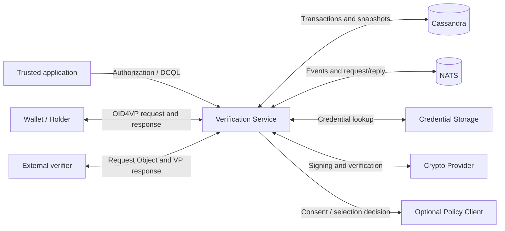
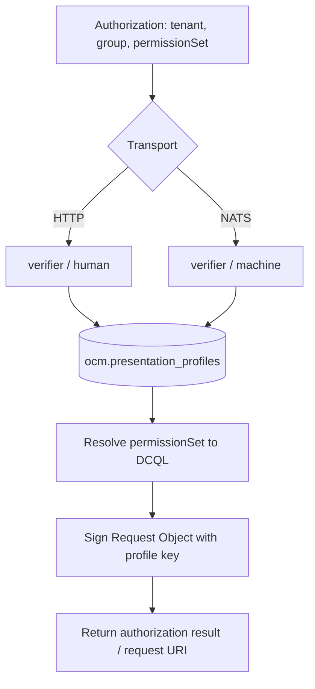
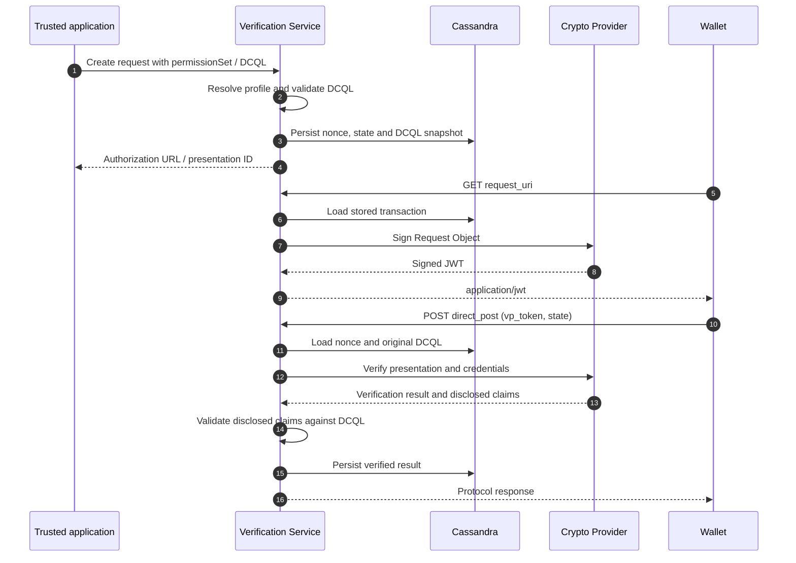
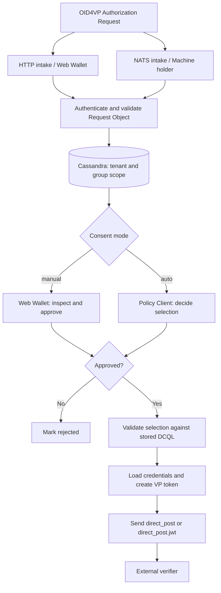
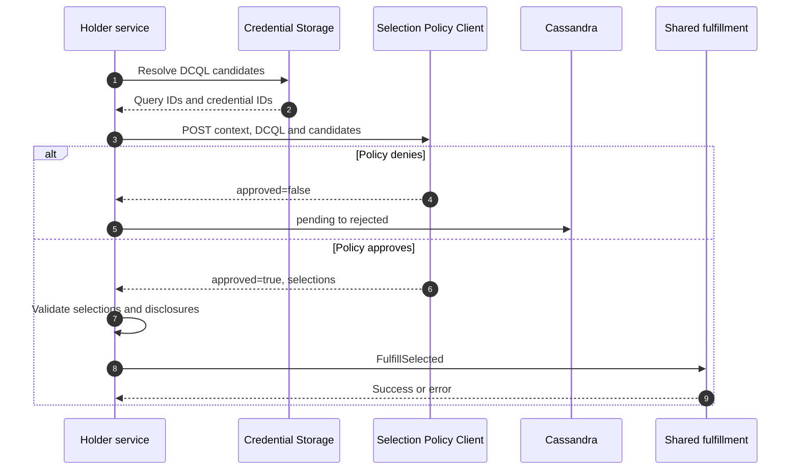
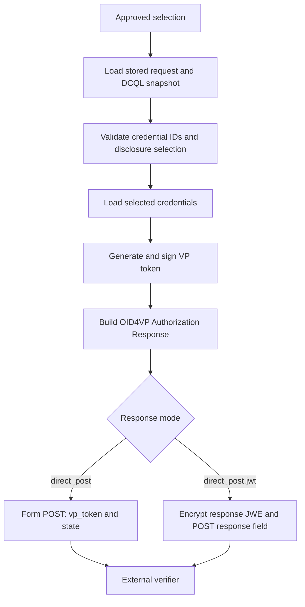

# XFSC OID4VC Credential Verification Service

OID4VP 1.0 service for **verifier** and **holder** workflows in the Eclipse XFSC OCM stack. It creates and processes OID4VP Authorization Requests, persists transaction state, matches credentials against DCQL, delegates cryptographic operations to the Crypto Provider, and integrates with Credential Storage, Cassandra and NATS.

> **Documentation scope:** This guide consolidates the supplied project documentation. Route names, event schemas and version numbers are drawn from that material; verify them against the exact deployed revision before production rollout. Legacy interfaces and unresolved discrepancies are called out explicitly.

## Contents

- [Architecture](#architecture)
- [Presentation profiles](#presentation-profiles)
- [Verifier workflow](#verifier-workflow)
- [Holder workflow](#holder-workflow)
- [Consent and selection](#consent-and-selection)
- [HTTP and NATS interfaces](#http-and-nats-interfaces)
- [Configuration](#configuration)
- [Security](#security)
- [Testing and operations](#testing-and-operations)
- [Known limitations and migration notes](#known-limitations-and-migration-notes)

## Architecture

The service operates in two distinct roles:

- **Verifier:** Creates a signed OID4VP Request Object from an authorized DCQL query, receives a wallet's `vp_token`, verifies the presentation and its disclosed claims, and stores/notifies the result.
- **Holder:** Accepts a signed request from an external verifier, retrieves matching credentials, obtains human or machine consent, builds a presentation, and sends it to the external verifier.



The **DCQL query stored with each transaction is authoritative**. Subsequent validation must use that snapshot, not a template that may have changed in the meantime. DCQL is the current query mechanism; `presentation_definition` / Presentation Exchange belongs to older integrations.

### Main dependencies

| Component | Responsibility |
| --- | --- |
| Cassandra | Transaction state, nonce, DCQL snapshot, consent state, presentation metadata |
| Credential Storage Service | Holder credential retrieval and DCQL candidate matching; storage events |
| Crypto Provider / Signer | Request Object signing, VP generation and cryptographic verification |
| NATS | Internal authorization request/reply, notifications and result retrieval |
| Policy Client | Optional automated consent / credential selection |
| OID4VP library | Request/response models, DCQL validation and matching |

The supplied documentation references Go 1.25 and `oid4-vci-vp-library v1.9.2`; check `go.mod` for the authoritative versions.

## Presentation profiles

Current profile-based configuration resolves OID4VP settings from the Cassandra table `ocm.presentation_profiles`, keyed by:

`(tenant_id, group_id, profile_type, interaction_type)`

The four combinations are `verifier/human`, `verifier/machine`, `holder/human`, and `holder/machine`. Verifier permission sets (for example `mitgliedschaft`) map to concrete DCQL JSON in the profile's `presentation_policies`. Profile UUIDs are internal; callers do not need them.



**Profile administration** uses tenant-scoped internal routes and the `x-groupid` partition:

| Method | Route suffix | Behavior |
| --- | --- | --- |
| `GET` | `/internal/presentation-profiles` | List all profile combinations, including disabled |
| `GET` | `/internal/presentation-profiles/{profileType}/{interactionType}` | Read one, including disabled |
| `PUT` | Same as GET one | Create/update; preserve `profileId` and `createdAt` |
| `DELETE` | Same as GET one | Idempotent deletion; `204 No Content` |

All routes above are relative to `/v1/tenants/{tenantId}`. The optional JWT/JWKS middleware is enabled by `CREDENTIALVERIFICATION_PROFILE_ADMIN_JWKS_URL`. When enabled, it checks signature, expiration, tenant/group context and the configured scope (default documented as `presentation-profiles:write`, including reads). Configure issuer and audience in production. When disabled, restrict the administration routes at the gateway.

See `docs/PRESENTATION_PROFILES.md`, `docs/PROFILE_ADMIN_JWT.md` and `scripts/profiles/README.md` if present in your checkout.

> **Important distinction:** The profile's embedded `presentation_policies` (permission set → DCQL) is **not** the external **credential-selection Policy Client** used for automatic holder consent. Older documentation about a separate presentation-policy service is superseded by profile-based configuration.

## Verifier workflow

An authorized application creates a presentation request via HTTP or NATS. The service persists the query, nonce and state, and serves a signed Request Object to the wallet. The wallet returns `vp_token` via `direct_post`.



The verifier's Request Object endpoint is documented as `GET /presentation/proof/{state}/request-object/request.jwt`. The response is the **raw compact JWT** with media type `application/jwt`, not a JSON string. The documented incoming response endpoint is `POST /presentation/proof/{state}` using form fields `vp_token` and `state`.

The service's own verifier endpoint currently advertises **`direct_post` only**. Incoming `direct_post.jwt` is not implemented according to the supplied operator guide. Do not confuse this with the holder's ability to **send** `direct_post.jwt` to an external verifier.

The verifier must perform both cryptographic checks and DCQL matching. In particular, SD-JWT issuer signatures, disclosure digests, key binding, `sd_hash`, `nonce` and `aud` must be verified by the responsible cryptographic component; the DCQL matcher must only process **verified** disclosed claims. An HTTP 200 from a verifier dependency alone does not establish validity.

## Holder workflow

The holder accepts a complete OID4VP Authorization URL or an equivalent trusted integration request. Both human and machine flows use the same request validation, credential lookup and fulfillment core. The immutable `consentMode` selects the decision path.



### Intake and persistence

- **Manual:** HTTP presentation creation through the Holder API, normally initiated by a Web Wallet.
- **Automatic:** NATS CloudEvent of type `verifier.presentation.authorization.remote`, with `consentMode: "auto"`, from an authorized machine client.
- **Shared:** Store `presentationId`, `tenantId`, `groupId`, `namespace`, `group`, `consentMode`, `status`, `dcqlQuery`, `clientId` and expiration in Cassandra.

The document describes statuses `pending`, `processing`, `completed`, `rejected`, `failed`, and `blocked`. Rejected requests are removed from the pending inbox but retained until their TTL expires. Atomic transitions must prevent duplicate fulfillment; TTL must survive status updates.

The external OID4VP `state` is distinct from the internal database status. Where present, it is persisted separately as `AuthorizationState` and returned unchanged to the external verifier. The document identifies migration `V003__add_authorization_state.cql`.

## Consent and selection

### Manual consent

The Web Wallet lists pending requests, displays the verifier and DCQL requirements, obtains matching credential candidates, and lets the holder approve, reject or block a verifier. The service must validate selections against the original DCQL snapshot and account ownership before signing.

### Automatic consent

The Policy Client receives tenant, group, verifier, DCQL and candidate credential identifiers. It must return an **explicit** decision. Approval without a valid selection fails closed.



Example policy input:

```json
{
  "tenantId": "demo-tenant",
  "groupId": "demo-account",
  "clientId": "decentralized_identifier:did:web:verifier.example",
  "dcqlQuery": {
    "credentials": [
      {
        "id": "identity",
        "format": "dc+sd-jwt",
        "meta": { "vct_values": ["https://issuer.example/types/identity"] },
        "claims": [{ "path": ["given_name"] }]
      }
    ]
  },
  "credentials": [{ "queryId": "identity", "credentialId": "credential-123" }]
}
```

Example approval:

```json
{
  "approved": true,
  "selections": [
    {
      "queryId": "identity",
      "credentialId": "credential-123",
      "disclosures": ["given_name"]
    }
  ]
}
```

To deny: `{"approved": false}`. For `ldp_vc`, omit `disclosures`. **Do not send `claimIds` to the documented current approval API**: an older architecture draft uses that field, but the later operator guide explicitly says it is rejected. Use `disclosures` where supported. Required claims must actually be disclosed; do not assume that DCQL matching implies consent.

### Shared fulfillment



For SD-JWT, the Crypto Provider receives the compact credential, expected `nonce` and audience (`clientId`) and produces a key-bound presentation. For LDP VC, the service builds a JSON-LD VP and delegates proof generation. Unsupported formats fail closed.

Holder **outgoing** response modes: `direct_post` and encrypted `direct_post.jwt` for supported credential formats. The documented `direct_post.jwt` implementation requires verifier metadata with an ECDH-ES / P-256 encryption JWK and supports `A128GCM` or `A256GCM`. The Request Object signature verification key is **not** interchangeable with the response encryption key in `client_metadata.jwks`.

## HTTP and NATS interfaces

All routes below are documented relative to the deployed tenant prefix, generally `/v1/tenants/{tenantId}`. Some earlier snippets show `/v1/{tenantId}`; use the actual router/gateway configuration as the source of truth.

| Role | Method | Route suffix | Purpose |
| --- | --- | --- | --- |
| Verifier | `GET` | `/presentation/request` | Legacy/alternative HTTP request creation |
| Verifier | `GET` | `/presentation/proof/{state}/request-object/request.jwt` | Serve signed Request Object |
| Verifier | `POST` | `/presentation/proof/{state}` | Receive `direct_post` |
| Verifier internal | `GET` | `/internal/presentations` | List verified presentation metadata |
| Verifier internal | `GET` | `/internal/presentations/{state}` | Retrieve verified presentation |
| Holder | `POST` | `/api/presentation/presentations` | Create holder request |
| Holder | `GET` | `/api/presentation/presentations` | Pending inbox |
| Holder | `GET` | `/api/presentation/presentations/{presentationId}` | Request details |
| Holder | `GET` | `/api/presentation/presentations/{presentationId}/candidates` | Matching credentials |
| Holder | `POST` | `/api/presentation/presentations/{presentationId}/approve` | Approve and transmit |
| Holder | `POST` | `/api/presentation/presentations/{presentationId}/reject` | Reject request |
| Profile admin | `GET/PUT/DELETE` | `/internal/presentation-profiles...` | Manage OID4VP profiles |

**Legacy:** `POST /internal/proofs/proof/{state}/fulfill` was removed in the later architecture. Older text that recommends this route is obsolete. The low-level `POST /internal/proofs/proof/{state}` is a separate legacy proof API, not a consent endpoint.

### NATS event types

| Type | Purpose |
| --- | --- |
| `verifier.presentation.authorization` | Create a verifier-side request |
| `verifier.presentation.authorization.remote` | Ingest an external request for the holder |
| `verifier.presentation.result.get` | Retrieve a locally verified presentation |
| `verifier.presentation.result.reply` | Result retrieval response |

The **CloudEvent `type` is not necessarily the NATS subject**. Configure subjects independently and use broker ACLs. A CloudEvent must include `specversion`, `id`, `source`, and `type`; a missing `source` makes the event invalid.

See [Operator guide](docs/OPERATOR_GUIDE.md) for request/reply payloads, curl examples and test scripts.

## Configuration

Representative service settings from the supplied documentation:

```yaml
isDev: false
country: DE
region: EU
storageServiceUrl: http://credential-storage-service:8080
signerService:
  presentationSignUrl: http://signer:8080/v1/presentation/proof
  presentationVerifyUrl: http://signer:8080/v1/presentation/verify
externalPresentation:
  credentialSelectionPolicy: http://policy-service:8080/policy/credential-selection
```

The actual configuration schema may differ by revision. In particular, the documented environment variables include:

| Variable | Purpose |
| --- | --- |
| `CREDENTIALVERIFICATION_STORAGE_URL` | Credential Storage HTTP base URL |
| `CREDENTIALVERIFICATION_STORAGE_TOPIC` | Storage event subject/topic; **not** the HTTP URL |
| `CREDENTIALVERIFICATION_PROFILE_ADMIN_JWKS_URL` | Enables profile-admin JWT verification when nonempty |
| `CREDENTIALVERIFICATION_PRESENTATIONPOLICY_URL` | **Legacy** external presentation-policy lookup; superseded by profiles |

`country` and `region` are currently described as static settings used to build Storage paths. A future Tenant Service could resolve them by tenant without changing OID4VP semantics.

## Security

1. **Authenticate external Request Objects.** The later security section documents DID-bound signature verification via `ssi-jwt/v2`, binding outer `client_id`, signed `client_id`, optional `iss` and DID `kid`. Reject attacker-supplied `jwk`, `jku` and `x5u` as trust anchors. Non-DID client identifier methods are not supported by that implementation. Earlier text claiming `ParseUnverified` is sufficient is obsolete and unsafe.
2. **Treat DID key control and verifier authorization separately.** A valid signature does not imply permission to request credentials. Apply client/request policy and consent.
3. **Constrain outbound URLs.** In production use HTTPS for external `request_uri`/`response_uri`; reject loopback/private/link-local targets, unsafe DNS resolutions and redirects. Do not forward inbound bearer tokens or cookies to external URLs. The supplied documentation specifies bounded responses and 10-second HTTP timeouts.
4. **Enforce tenant and holder isolation.** The gateway must authenticate users and replace untrusted `x-tenantid`, `x-groupid`, `x-namespace` and `x-group` headers. `groupId` is the holder account; `group` is the Crypto Provider key group. They are not interchangeable.
5. **Enforce one-time fulfillment.** Use atomic status transitions and immutable consent mode, holder context, nonce and DCQL snapshot. After a successful network submission, automatic retry risks duplicate disclosure; exactly-once recovery requires a durable outbox.
6. **Verify credentials before DCQL matching.** Only cryptographically validated SD-JWT disclosures may be matched. Validate issuer signature, disclosure integrity, KB-JWT holder binding, `sd_hash`, audience and nonce as applicable.
7. **Protect internal interfaces.** Restrict `/internal/**` at the gateway and apply NATS subject ACLs. A signed state is not a replacement for authorization.

### Profile administration JWT

When enabled, the profile-admin middleware requires a signed bearer token with expiration, matching tenant/group and configured scope. Set issuer/audience and secure the JWKS source. The supplied documentation describes a five-minute JWKS cache. When disabled, these endpoints must not be publicly reachable.

## Testing and operations

```bash
go test ./...
go vet ./...
```

End-to-end validation should cover:

- Profile resolution by tenant, group, role and interaction type.
- Signed Request Object generation and verification, including `client_id`/`kid` binding.
- SD-JWT and LDP VC verification against persisted DCQL; positive and negative disclosure cases.
- Manual and automatic consent, rejection, blocked verifiers and concurrent approvals.
- `direct_post` and holder outgoing `direct_post.jwt` with valid and invalid encryption metadata.
- Storage DIRECT-mode retrieval and NATS event publication, including mandatory CloudEvent attributes.
- Tenant/group isolation, URL/redirect/SSRF restrictions, expiration and Cassandra TTL behavior.

The original documentation calls for a complete Go build, signer integration tests, Cassandra migration tests and end-to-end tests against a trusted external verifier before production rollout. See [Operator guide](docs/OPERATOR_GUIDE.md) for practical steps.

## Known limitations and migration notes

- **Profiles replace the legacy presentation-policy lookup.** A separate credential-selection Policy Client can still be used for machine consent.
- **Removed endpoint:** `/internal/proofs/proof/{state}/fulfill`. Use the Holder API or NATS machine intake.
- **Selection schema:** Current examples use `disclosures`; older `claimIds` examples are deprecated.
- **Verifier inbound `direct_post.jwt`:** Not implemented in the supplied revision; holder outgoing support is distinct.
- **DID verifier identities:** Supported by the documented Request Object verification path; other client identifier methods need explicit implementations.
- **Route prefixes:** Verify gateway routing; older documents inconsistently use `/v1/{tenantId}` and `/v1/tenants/{tenantId}`.
- **NATS URI construction:** The original operator guide warns that a host field containing a path can generate invalid URLs. Validate returned authorization URLs.
- **Legacy scripts and documentation:** Old `presentation_definition`, `/fulfill` and external presentation-policy examples should not be reused without migration.
