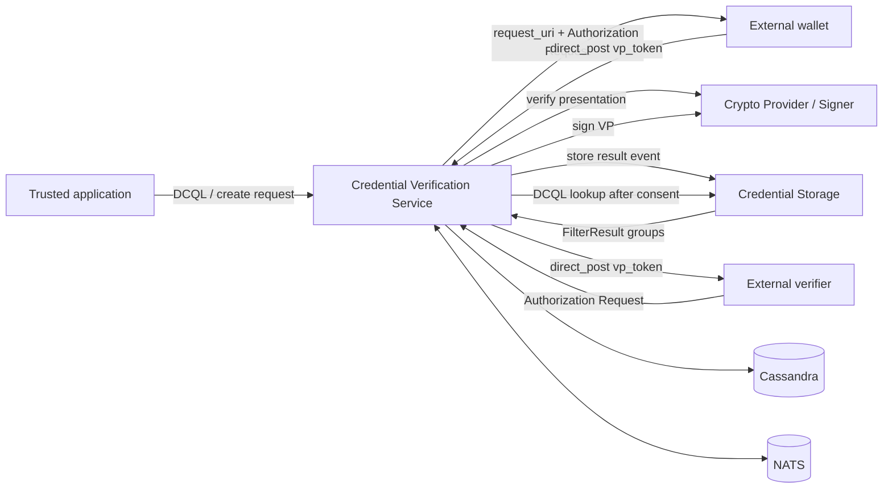
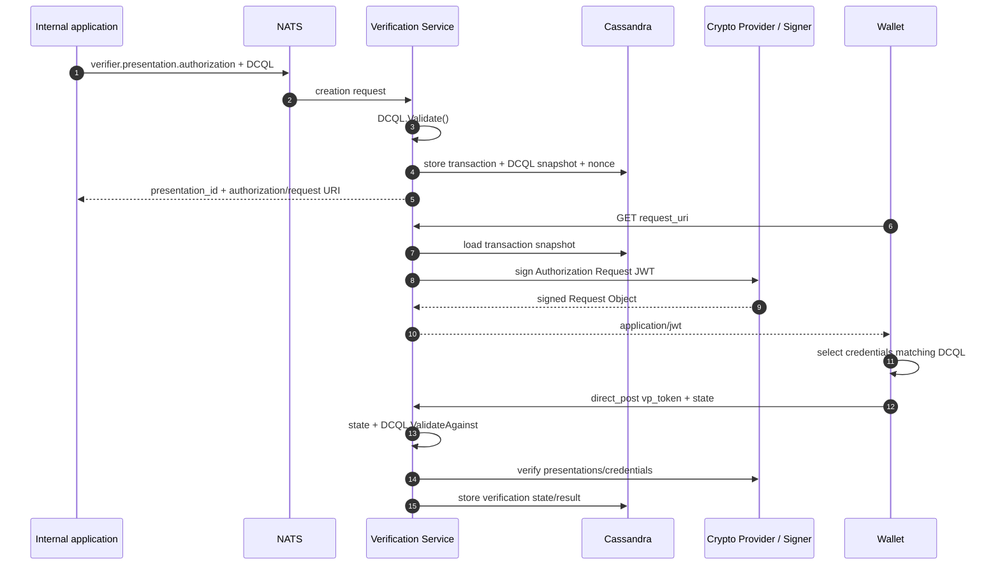
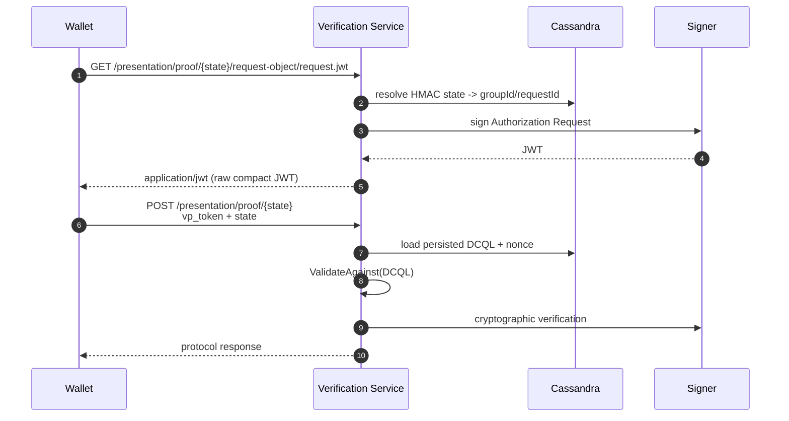
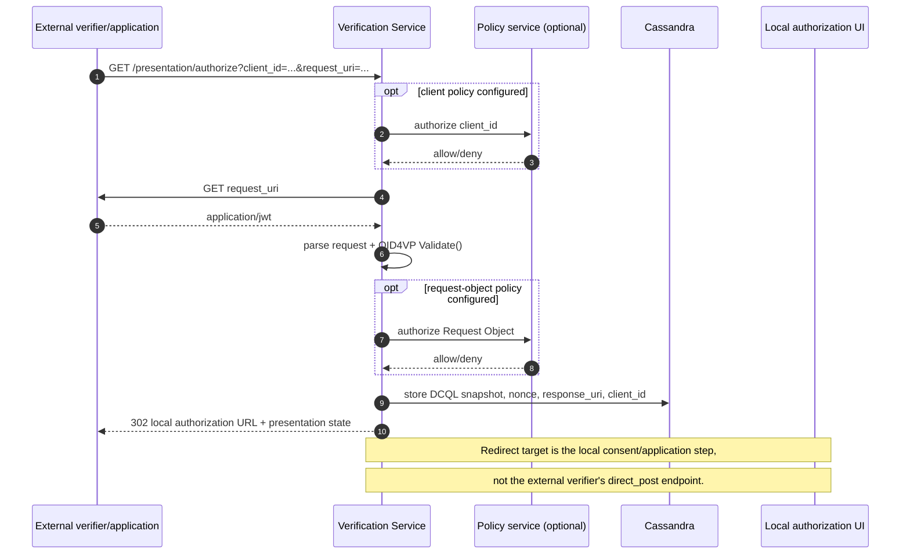
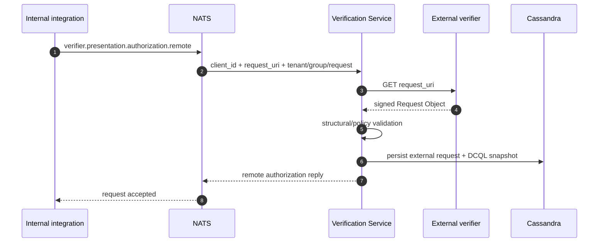
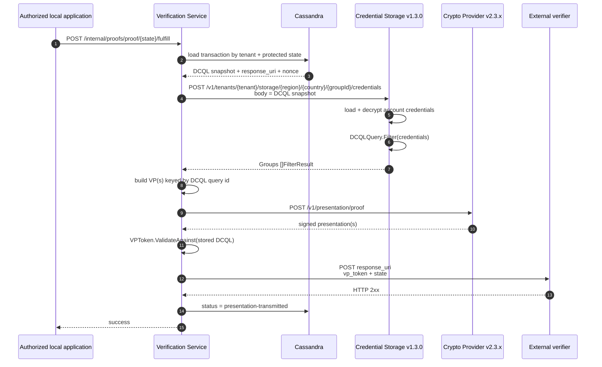
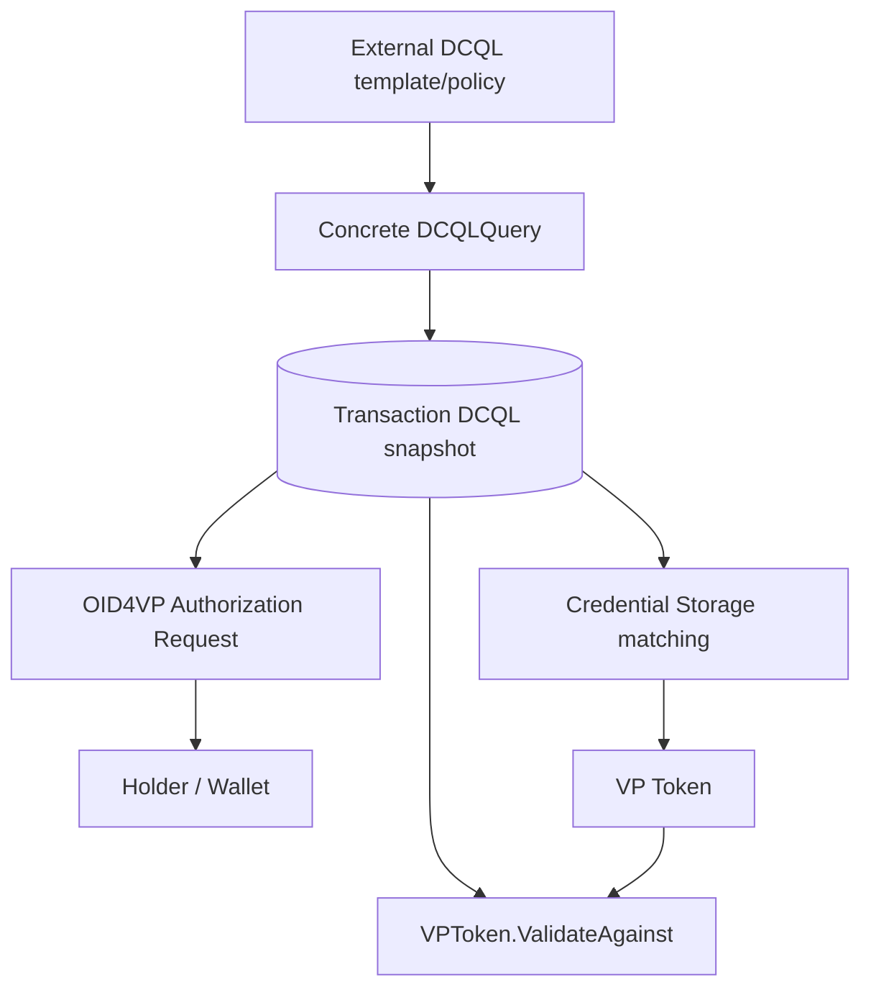
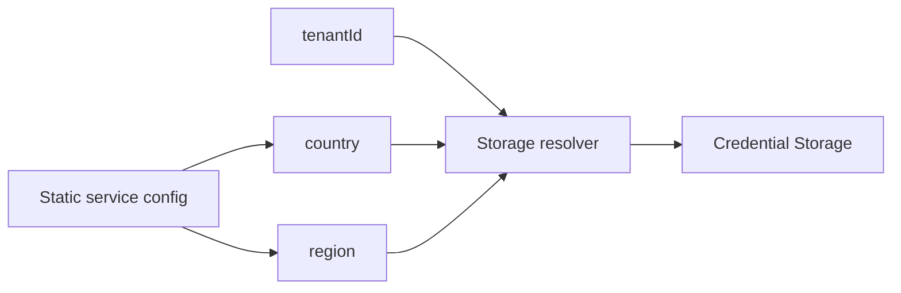
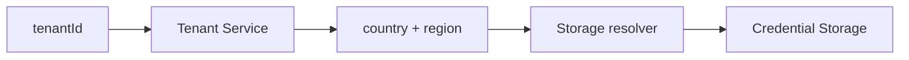
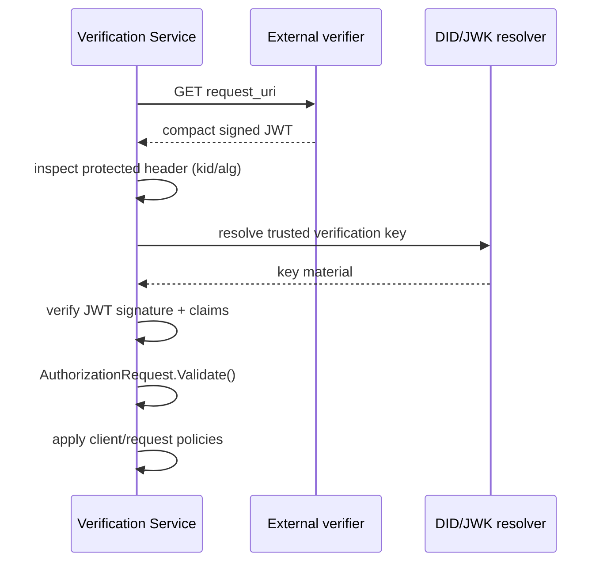

# OID4VC Credential Verification Service

The Credential Verification Service implements the verifier-facing and holder-facing OID4VP flows used by the XFSC OCM stack. It supports OID4VP 1.0/DCQL through `oid4-vci-vp-library v1.9.2` and integrates with Credential Storage, Crypto Provider/Signer, Cassandra and NATS.

> **Terminology:** this service uses **DCQL**. `presentation_definition` / Presentation Exchange is legacy terminology and is not part of the current OID4VP flow described here.

## Responsibilities and trust boundaries

The service has two different protocol roles. Keeping them separate is essential:

- **Verifier role (outbound request):** an internal trusted application supplies an already-authorized DCQL query. The service creates a transaction and OID4VP Authorization Request. A wallet selects credentials and sends a `vp_token` back.
- **Holder role (inbound external request):** an external verifier supplies an OID4VP Authorization Request. The service stores its DCQL query as a transaction snapshot. After the local application authorizes disclosure, the service resolves matching credentials from Credential Storage, creates/signs the presentation and sends it to the external verifier's `response_uri`.

DCQL templates and business policy are intentionally **external concerns**. This service consumes a concrete DCQL query and stores the exact query with the transaction.



## Configuration

The service is built with Go 1.25 and currently uses, among others:

- `oid4-vci-vp-library v1.9.2`
- `credential-storage-service v1.3.0`
- `crypto-provider-service/v2 v2.3.7`
- `microservice-core-go v1.1.2`

Important configuration values are:

```yaml
country: DE
region: EU
storageServiceUrl: http://credential-storage-service:8080
signerService:
  presentationSignUrl: http://signer:8080/v1/presentation/proof
  presentationVerifyUrl: http://signer:8080/v1/presentation/verify
```

`country` and `region` are **temporarily static service configuration**. Credential Storage v1.3.0 addresses credentials by tenant, region, country and account. The holder flow isolates this dependency in the Storage resolver. A future Tenant Service should resolve `country` and `region` from `tenantId`; the OID4VP and DCQL flow does not need to change.

The HTTP base URL of Credential Storage is configured with:

```text
CREDENTIALVERIFICATION_STORAGE_URL
```

The NATS storage topic remains separate:

```text
CREDENTIALVERIFICATION_STORAGE_TOPIC
```

`STORAGE_URL` is for credential **retrieval/DCQL matching** over HTTP. `STORAGE_TOPIC` is for storage events.

## Scenario 1 — Internal creation of an OID4VP request (verifier role)

A trusted internal service has already selected/authorized a concrete DCQL query. It requests a presentation through NATS (`verifier.presentation.authorization`). The Verification Service persists the DCQL snapshot and creates an OID4VP request URI.



The wallet-facing `request_uri` does **not** generate or modify DCQL. It serializes the DCQL snapshot already stored for the transaction.

## Scenario 2 — Wallet-facing request_uri and direct_post

The externally visible protocol endpoints are tenant-scoped by `microservice-core-go` under `/v1/tenants/{tenantId}`.



The JWT response is returned as raw `application/jwt`; it is not JSON-quoted.

## Scenario 3 — External Authorization Request through HTTP (holder role)

A permitted external application/verifier can start the holder flow through the authorization endpoint. The service fetches the external `request_uri`, validates the OID4VP request structure and policies, stores the request/DCQL snapshot and redirects to the configured local authorization UI/application.



Headers currently used to bind the local account/transaction are `x-groupId` (storage account), `x-requestId`, and holder signing metadata as required by the surrounding application.

## Scenario 4 — External Authorization Request through NATS

The same inbound request can enter through NATS (`verifier.presentation.authorization.remote`). This is a transport alternative; it is not a different OID4VP protocol.



The actual credential disclosure is a separate fulfillment step. This prevents receipt of an Authorization Request from automatically consenting to credential disclosure.

## Scenario 5 — Fulfill an external request from Credential Storage

After the local application/user has authorized disclosure, call:

```http
POST /v1/tenants/{tenantId}/internal/proofs/proof/{state}/fulfill
Content-Type: application/json
```

Example body:

```json
{
  "holderDid": "did:web:holder.example",
  "signKey": "presentation-key",
  "signNamespace": "tenant-1",
  "signGroup": "account-123"
}
```

Only signing material is accepted. **Credentials are not accepted from the caller.** The service resolves them itself using the stored DCQL snapshot.



### Storage contract

The implementation follows the uploaded Credential Storage Service v1.3.0 DIRECT-mode API:

```text
POST {STORAGE_URL}/v1/tenants/{tenantId}/storage/{region}/{country}/{account}/credentials
Content-Type: application/json
Body: DCQLQuery
```

The Storage Service decrypts the account credentials and evaluates `DCQLQuery.Filter(...)`. The relevant response field is:

```json
{
  "groups": [
    {
      "id": "<dcql credential query id>",
      "credentials": {}
    }
  ]
}
```

In the current Verification Service deployment `groupId` is used as the Storage `account`. This is also the identifier used for the service's account partitioning.

## Manual/legacy proof endpoint

The existing endpoint that accepts `ProofModel.Payload` is retained for compatibility:

```text
POST /v1/tenants/{tenantId}/internal/proofs/proof/{state}
```

New integrations should prefer `/fulfill`, because `/fulfill` derives credentials from the persisted DCQL query and Credential Storage rather than trusting credential groups supplied by the caller.

## State, nonce and DCQL snapshot

Each transaction stores the concrete DCQL query. This is intentional: template/policy configuration can change while a transaction is active, but the eventual `vp_token` must be checked against the exact request the holder received.



The route state is HMAC protected and resolves to `groupId + requestId`. The nonce is persisted with the transaction and used for presentation verification.

## Country/region and future Tenant Service

Today:



Later, only this part should change:



Do not move DCQL templates into this Tenant Service implicitly. DCQL management remains an external policy/template concern unless that architecture is changed explicitly.

## Security: external Request Object verification

The inbound external flow currently parses the compact JWT in order to obtain the OID4VP request claims and then applies OID4VP structural validation and configured policies. **Cryptographic Request Object signature verification against trusted client key material is still a required production hardening step.** Parsing a JWT with `ParseUnverified` is not proof of authenticity and no claim obtained from that parsing should be treated as authenticated solely because parsing succeeded.

The intended final sequence is:



Until that resolver/verification path is implemented, deployments must not treat arbitrary Internet `request_uri` values as authenticated request objects merely because their JWT can be decoded.

## Dependency interaction summary

| Dependency | Purpose |
|---|---|
| Cassandra | transaction state, nonce, DCQL snapshot and received/sent presentation state |
| Credential Storage Service | credential retrieval and DCQL matching for holder-side fulfillment; presentation/result storage events |
| Crypto Provider / Signer | sign generated presentations and verify received presentations/credentials; sign verifier Request Objects through the signer messaging flow |
| NATS | internal request creation, inbound integration and notifications |
| External policy endpoint | optional client/request authorization |
| Future Tenant Service | resolve tenant-dependent country/region (planned, not currently required) |

## Build and validation

The module declares Go 1.25.0. Run in an environment with Go 1.25 available:

```bash
go test ./...
go vet ./...
```

For an end-to-end holder test, run Credential Storage in **DIRECT** mode, seed credentials for the same tenant/region/country/account (`groupId`), submit an external Authorization Request containing DCQL, authorize it locally, then invoke `/fulfill` and verify that the external verifier receives `vp_token` via `direct_post`.
