# OID4VC Credential Verification Service

## Security hardening and production configuration (October 2026)

**External Request Objects are authenticated before any request claims are used.** The
External DID-based Request Objects are verified using the `ssi-jwt/v2` DID key resolver. The outer `client_id` must match the signed claim, and `kid` must identify a key of that DID. Non-DID client identifier methods fail closed until supported.

The uploaded Crypto Provider currently offers `/v1/sign`,
`/v1/credential/verify`, `/v1/presentation/verify`, and
`/v1/presentation/proof`; it does **not** expose a general JWS Request Object
verification endpoint. We therefore verify external Request Objects against a
DID-bound SSI-JWT verification instead of incorrectly treating credential verification
as JWT signature verification. If the Signer gains a generic JWS verification
API, this trust adapter can be replaced without changing the flow.

**Network controls:** External `request_uri` and `response_uri` must use HTTPS
outside development. `isDev: true` permits HTTP for local testing. External
URLs cannot point to loopback/private/link-local IP addresses in production,
including after DNS resolution. HTTP 3xx responses are rejected and **never
followed**, including on `direct_post`. All outbound HTTP clients have
10-second timeouts and bounded responses. Internal Storage/Signer/Policy
service URLs may use Kubernetes-internal HTTP, but also reject redirects.

**Do not forward bearer tokens or cookies** from the inbound authorization
request when dereferencing an external `request_uri`.

### Holder fulfillment with consent/selection policy

`externalPresentation.credentialSelectionPolicy` is optional for trusted
headless use. When configured, `/fulfill` sends this JSON request to the
existing Policy Service over HTTP:

```json
{
  "tenantId": "tenant-a",
  "groupId": "account-a",
  "clientId": "decentralized_identifier:did:web:verifier.example",
  "dcqlQuery": {"credentials": [{"id": "identity", "format": "dc+sd-jwt", "meta": {"vct_values": ["urn:example:identity"]}}]},
  "candidates": [{"description": {"id": "identity"}, "credentials": {"credential-key-1": "<credential>"}}]
}
```

Policy Service response:

```json
{
  "allow": true,
  "selection": {
    "identity": ["credential-key-1"]
  }
}
```

`allow: false` denies disclosure. If `allow: true` and `selection` is absent
or empty, all matched candidates are used. If `selection` is provided, only
those query IDs and credential keys are retained; unknown credential keys or
empty selections fail closed. Consent and user interaction happen **before**
`/fulfill`; the service never infers user consent from DCQL matching.

```mermaid
sequenceDiagram
    participant App as Authorized Application / Consent UI
    participant CVS as Verification Service (Holder role)
    participant DB as Cassandra
    participant Storage as Credential Storage
    participant Policy as Policy Service
    participant Signer as Crypto Provider / Signer
    participant V as External Verifier
    App->>CVS: POST /internal/proofs/proof/{state}/fulfill (signing identity)
    CVS->>DB: Load stored external Request Object / DCQL
    CVS->>DB: CAS requested -> fulfilling
    CVS->>Storage: POST DCQL /v1/tenants/{tenant}/storage/{region}/{country}/{account}/credentials
    Storage-->>CVS: FilterResult groups
    CVS->>Policy: tenant, clientId, DCQL, candidates
    Policy-->>CVS: allow + selection per query ID / credential key
    alt denied or no matches
        CVS-->>App: error, no presentation sent
    else allowed
        loop each selected DCQL query
            CVS->>Signer: POST /v1/presentation/proof (format, aud, nonce, credential)
            Signer-->>CVS: signed ldp_vc VP or dc+sd-jwt presentation
        end
        CVS->>CVS: VPToken.ValidateAgainst(persisted DCQL)
        CVS->>V: POST response_uri (vp_token, original external state)
        Note over CVS,V: Redirects forbidden; HTTPS outside dev
        V-->>CVS: HTTP 2xx
        CVS->>DB: status = presentation-transmitted
        CVS-->>App: success
    end
```

### Transaction state and external OID4VP state

`VerificationEntry.State` remains the internal database **status**. The
external verifier's optional OID4VP `state` is stored separately in
`VerificationEntry.AuthorizationState` (Cassandra migration
`V003__add_authorization_state.cql`) and is returned **unchanged** in the
`direct_post` response. An absent external state is not fabricated. The
fulfillment path acquires a Cassandra conditional update
`presentation-requested -> presentation-fulfilling` to reject concurrent
submissions. On failure before transmission it releases the claim; after a
successful network submission it never automatically retries, to avoid
releasing the same credentials twice. A durable outbox would be required for
exactly-once recovery across process crashes.

### Format-specific signing

The Crypto Provider's `/v1/presentation/proof` endpoint is used for both
`ldp_vc` and `dc+sd-jwt`. For SD-JWT the service passes the original compact
SD-JWT, `format: dc+sd-jwt`, stored `nonce`, `aud: clientId`, and holder signing
identity; the Signer creates the key-bound SD-JWT presentation. For LDP VC,
the service constructs a JSON-LD VP and asks the Signer for its proof.
Unsupported formats fail closed. Manual legacy proof submission cannot create
SD-JWT presentations without the persisted transaction audience/nonce.

### Configuration and later Tenant Service

```yaml
isDev: false
country: DE
region: EU
externalPresentation:
  clientIdPolicy: http://policy-service:8080/policy/client
  credentialSelectionPolicy: http://policy-service:8080/policy/credential-selection
```

`country` and `region` deliberately remain **static service settings**. The
Storage adapter consumes these fields when constructing the retrieval path.
A future Tenant Service should resolve them from `tenantId` there; it must not
change DCQL, signer or external Request Object semantics.

### Swagger, Insomnia, Playground

- `docs/swagger.json`, `docs/swagger.yaml`, `docs/docs.go` describe the
  tenant-scoped routes and `/fulfill`.
- `docs/Insomnia_OID4VP_2026.json` replaces the legacy Presentation Exchange
  collection; it includes direct-post, Request Object, authorization, internal
  proof and fulfillment routes.
- Docker playground includes Holder Fulfillment and tenant-qualified URLs;
  its HTTP client does not follow redirects.

**Deployment caution:** A complete Go 1.25 build, signer integration tests,
Cassandra migration test, and an end-to-end test with a trusted external
verifier are still required before production rollout. The existing manual
proof route is retained for compatibility and should be restricted to
privileged internal callers.


The Credential Verification Service implements the verifier-facing and holder-facing OID4VP flows used by the XFSC OCM stack. It supports OID4VP 1.0/DCQL through `oid4-vci-vp-library v1.9.2` and integrates with Credential Storage, Crypto Provider/Signer, Cassandra and NATS.

> **Terminology:** this service uses **DCQL**. `presentation_definition` / Presentation Exchange is legacy terminology and is not part of the current OID4VP flow described here.

## Responsibilities and trust boundaries

The service has two different protocol roles. Keeping them separate is essential:

- **Verifier role (outbound request):** an internal trusted application supplies an already-authorized DCQL query. The service creates a transaction and OID4VP Authorization Request. A wallet selects credentials and sends a `vp_token` back.
- **Holder role (inbound external request):** an external verifier supplies an OID4VP Authorization Request. The service stores its DCQL query as a transaction snapshot. After the local application authorizes disclosure, the service resolves matching credentials from Credential Storage, creates/signs the presentation and sends it to the external verifier's `response_uri`.

DCQL templates and business policy are intentionally **external concerns**. This service consumes a concrete DCQL query and stores the exact query with the transaction.

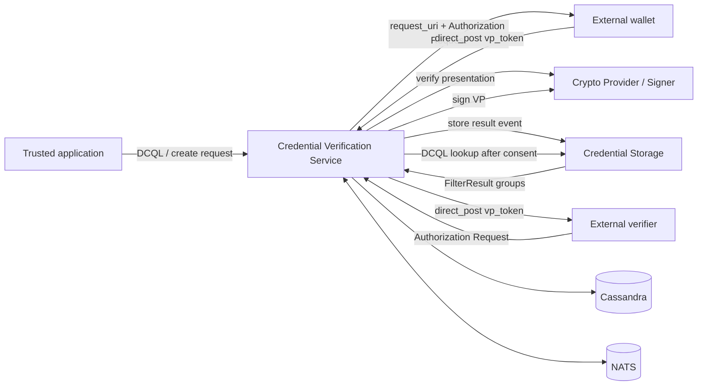

## Configuration

The service is built with Go 1.25 and currently uses, among others:

- `oid4-vci-vp-library v1.9.2`
- `credential-storage-service v1.3.0`
- `crypto-provider-service/v2 v2.3.7`
- `microservice-core-go v1.1.2`

Important configuration values are:

```yaml
country: DE
region: EU
storageServiceUrl: http://credential-storage-service:8080
signerService:
  presentationSignUrl: http://signer:8080/v1/presentation/proof
  presentationVerifyUrl: http://signer:8080/v1/presentation/verify
```

`country` and `region` are **temporarily static service configuration**. Credential Storage v1.3.0 addresses credentials by tenant, region, country and account. The holder flow isolates this dependency in the Storage resolver. A future Tenant Service should resolve `country` and `region` from `tenantId`; the OID4VP and DCQL flow does not need to change.

The HTTP base URL of Credential Storage is configured with:

```text
CREDENTIALVERIFICATION_STORAGE_URL
```

The NATS storage topic remains separate:

```text
CREDENTIALVERIFICATION_STORAGE_TOPIC
```

`STORAGE_URL` is for credential **retrieval/DCQL matching** over HTTP. `STORAGE_TOPIC` is for storage events.

## Scenario 1 — Internal creation of an OID4VP request (verifier role)

A trusted internal service has already selected/authorized a concrete DCQL query. It requests a presentation through NATS (`verifier.presentation.authorization`). The Verification Service persists the DCQL snapshot and creates an OID4VP request URI.

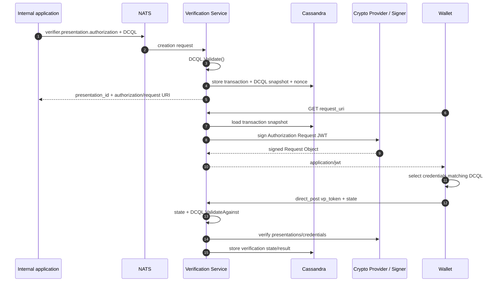

The wallet-facing `request_uri` does **not** generate or modify DCQL. It serializes the DCQL snapshot already stored for the transaction.

## Scenario 2 — Wallet-facing request_uri and direct_post

The externally visible protocol endpoints are tenant-scoped by `microservice-core-go` under `/v1/tenants/{tenantId}`.

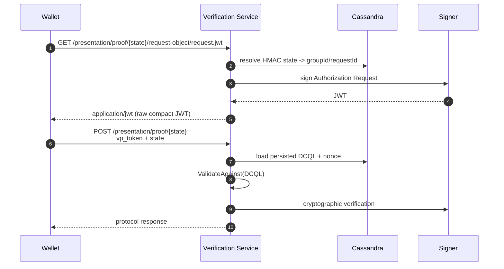

The JWT response is returned as raw `application/jwt`; it is not JSON-quoted.

## Scenario 3 — External Authorization Request through HTTP (holder role)

A permitted external application/verifier can start the holder flow through the authorization endpoint. The service fetches the external `request_uri`, validates the OID4VP request structure and policies, stores the request/DCQL snapshot and redirects to the configured local authorization UI/application.

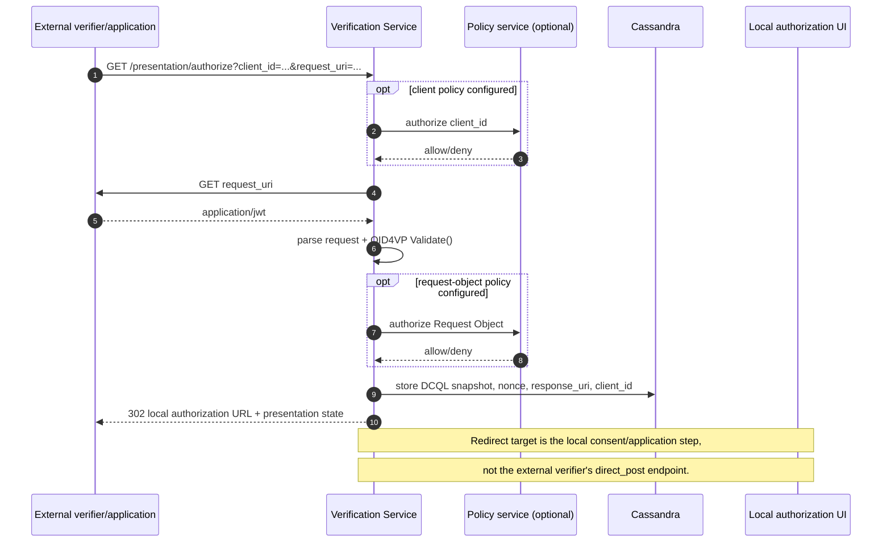

Headers currently used to bind the local account/transaction are `x-groupId` (storage account), `x-requestId`, and holder signing metadata as required by the surrounding application.

## Scenario 4 — External Authorization Request through NATS

The same inbound request can enter through NATS (`verifier.presentation.authorization.remote`). This is a transport alternative; it is not a different OID4VP protocol.

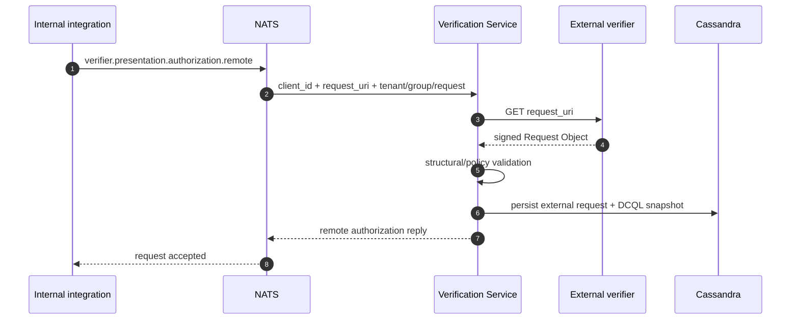

The actual credential disclosure is a separate fulfillment step. This prevents receipt of an Authorization Request from automatically consenting to credential disclosure.

## Scenario 5 — Fulfill an external request from Credential Storage

**The old `POST /internal/proofs/proof/{state}/fulfill` endpoint was removed.**
It bypassed the consent selection contract and could not carry SD-JWT disclosures.
For manual approval use the Holder API `POST /api/presentation/presentations/{presentationId}/approve`.
For machine approval send the NATS `verifier.presentation.authorization.remote` request with `consentMode=auto`.
Both use `FulfillSelected`, DCQL validation, the same signer and the same `direct_post`/`direct_post.jwt` submission code.

### Storage contract

The implementation follows the uploaded Credential Storage Service v1.3.0 DIRECT-mode API:

```text
POST {STORAGE_URL}/v1/tenants/{tenantId}/storage/{region}/{country}/{account}/credentials
Content-Type: application/json
Body: DCQLQuery
```

The Storage Service decrypts the account credentials and evaluates `DCQLQuery.Filter(...)`. The relevant response field is:

```json
{
  "groups": [
    {
      "id": "<dcql credential query id>",
      "credentials": {}
    }
  ]
}
```

In the current Verification Service deployment `groupId` is used as the Storage `account`. This is also the identifier used for the service's account partitioning.

## Manual/legacy proof endpoint

The low-level internal `ProofModel.Payload` endpoint is retained only for legacy non-consent workflows. It is **not** a manual or machine consent API; use the Holder approval endpoint below.

```text
POST /v1/tenants/{tenantId}/internal/proofs/proof/{state}
```

New integrations should prefer `/fulfill`, because `/fulfill` derives credentials from the persisted DCQL query and Credential Storage rather than trusting credential groups supplied by the caller.

## State, nonce and DCQL snapshot

Each transaction stores the concrete DCQL query. This is intentional: template/policy configuration can change while a transaction is active, but the eventual `vp_token` must be checked against the exact request the holder received.

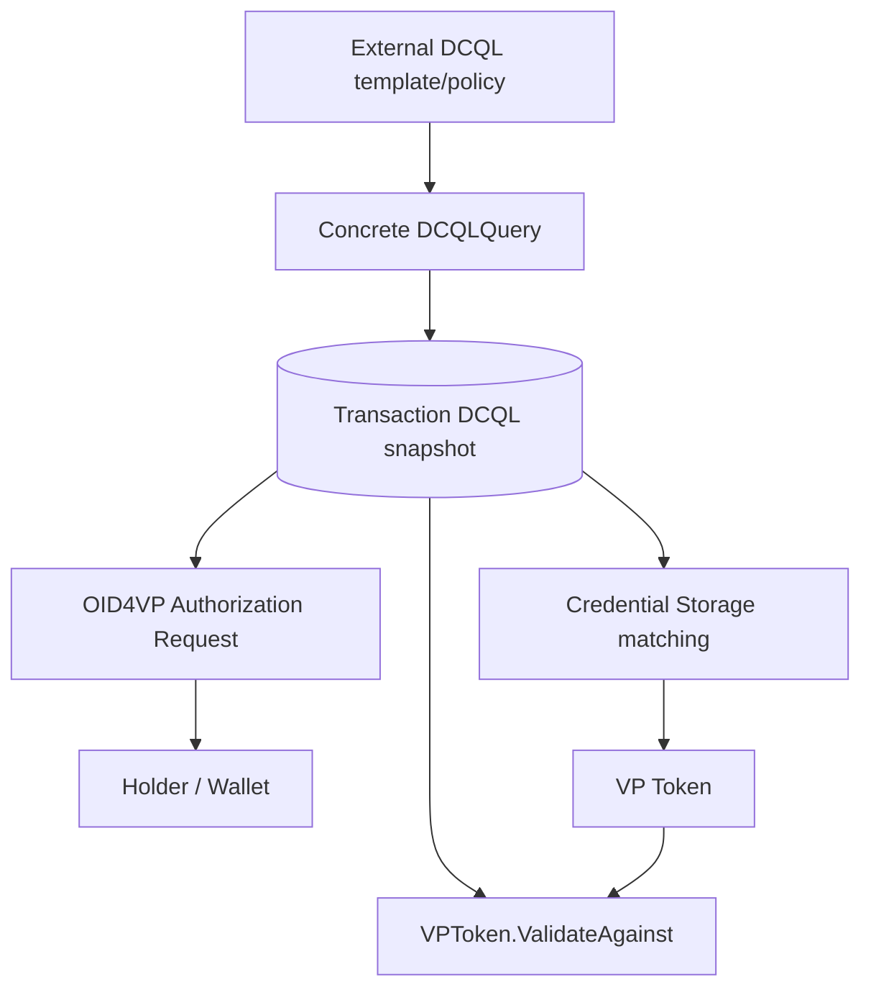

The route state is HMAC protected and resolves to `groupId + requestId`. The nonce is persisted with the transaction and used for presentation verification.

## Country/region and future Tenant Service

Today:

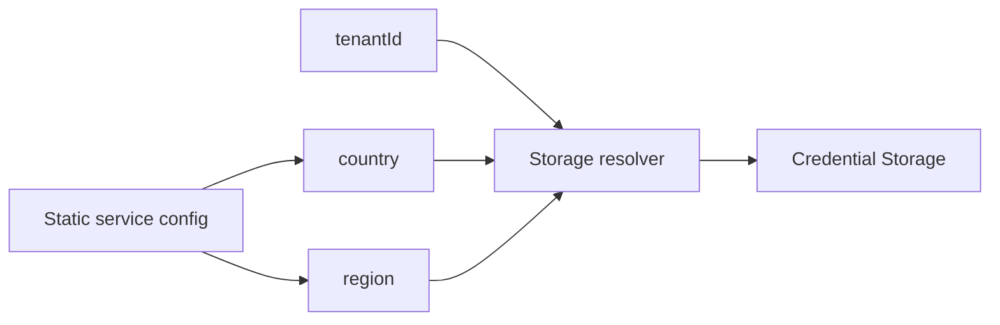

Later, only this part should change:

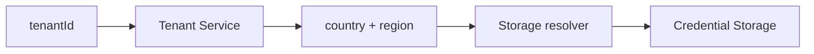

Do not move DCQL templates into this Tenant Service implicitly. DCQL management remains an external policy/template concern unless that architecture is changed explicitly.

## Security: external Request Object verification

The inbound external flow currently parses the compact JWT in order to obtain the OID4VP request claims and then applies OID4VP structural validation and configured policies. **Cryptographic Request Object signature verification against trusted client key material is still a required production hardening step.** Parsing a JWT with `ParseUnverified` is not proof of authenticity and no claim obtained from that parsing should be treated as authenticated solely because parsing succeeded.

The intended final sequence is:

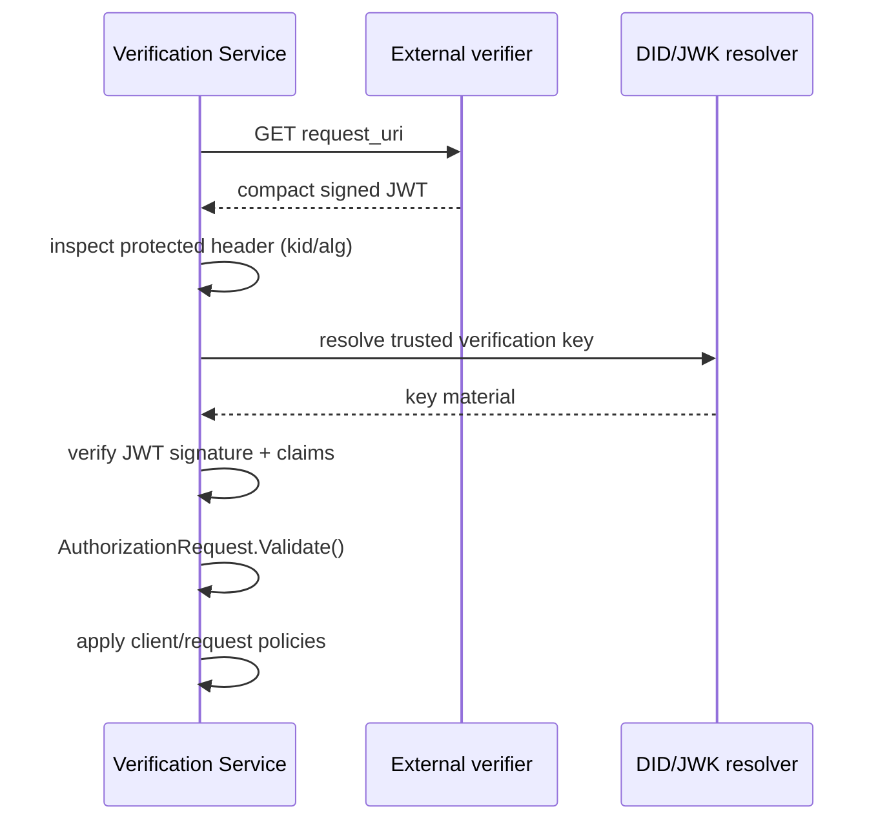

Until that resolver/verification path is implemented, deployments must not treat arbitrary Internet `request_uri` values as authenticated request objects merely because their JWT can be decoded.

## Dependency interaction summary

| Dependency | Purpose |
|---|---|
| Cassandra | transaction state, nonce, DCQL snapshot and received/sent presentation state |
| Credential Storage Service | credential retrieval and DCQL matching for holder-side fulfillment; presentation/result storage events |
| Crypto Provider / Signer | sign generated presentations and verify received presentations/credentials; sign verifier Request Objects through the signer messaging flow |
| NATS | internal request creation, inbound integration and notifications |
| External policy endpoint | optional client/request authorization |
| Future Tenant Service | resolve tenant-dependent country/region (planned, not currently required) |

## Build and validation

The module declares Go 1.25.0. Run in an environment with Go 1.25 available:

```bash
go test ./...
go vet ./...
```

For an end-to-end holder test, run Credential Storage in **DIRECT** mode, seed credentials for the same tenant/region/country/account (`groupId`), submit an external Authorization Request containing DCQL, authorize it locally, then invoke `/fulfill` and verify that the external verifier receives `vp_token` via `direct_post`.

**Known limitation:** Only DID-based external verifier identities are supported. Other OID4VP client identifier methods require their own resolvers. HTTP `authUrl` overrides are permitted only in dev mode.


## External Request Object verification (DID profile)

The holder resolves `request_uri` without redirects and passes the **outer** `client_id` into the verifier. The compact JWS header and payload are decoded as **untrusted** input only to select a DID verification method. The `kid` must refer to that same DID, and embedded/remote attacker-selected key sources (`jwk`, `jku`, `x5u`) are rejected. `ssi-jwt/v2.Parse` resolves the DID key and verifies the signature. The verified `client_id` must equal the outer `client_id`; `iss`, when present, must also match. Only after verification does OID4VP request validation and the policy/consent path run.

**Scope:** This implementation supports DID-based verifier identities only. X.509, verifier attestation and other client identifier methods require separate resolvers and currently fail closed. A DID signature proves key control, not that a verifier is authorized to receive credentials; policy must still decide. DID resolution must be restricted to trusted resolver methods and egress rules in production.

## `direct_post` and `direct_post.jwt`

The Holder flow treats presentation format and Authorization Response mode as independent protocol dimensions.

| DCQL credential format | `direct_post` | `direct_post.jwt` |
| --- | --- | --- |
| `dc+sd-jwt` | supported | supported |
| `ldp_vc` | supported | supported |

For `direct_post`, the service posts `vp_token` and the external `state` as `application/x-www-form-urlencoded` fields.

For `direct_post.jwt`, the service builds the same OID4VP `AuthorizationResponse`, encrypts it as a compact JWE, and posts it in the single `response` form field. The current response encryptor supports Verifier metadata containing an `ECDH-ES` / `P-256` encryption JWK and selects `A128GCM` (preferred/default) or `A256GCM` from `encrypted_response_enc_values_supported`. The authenticated Request Object's `client_metadata` is persisted with the presentation transaction so the encryption key remains available after consent and credential selection.

The Request Object signature key and the Authorization Response encryption key have different purposes. A DID verification method (`kid` in the Request Object JWS) authenticates the Request Object. `client_metadata.jwks` supplies the Verifier's response-encryption key and is never used as a replacement for Request Object signature verification.

A request using an unsupported response mode, encryption key type, key agreement algorithm, or content-encryption algorithm fails closed. Credential format selection remains in the presentation builder and is not inferred from `response_mode`.

OID4VP Holder Architecture

The XFSC Holder supports both human-operated wallets and machine-to-machine (M2M) presentations.

Both workflows share the same OID4VP request validation, persistent storage, credential matching, and presentation fulfillment logic. The consent process differs depending on the mode assigned when the authorization request is submitted.

Architecture Overview

flowchart TD
    A["OID4VP Authorization Request"]
    A --> B["HTTP Intake<br/>Web Wallet"]
    A --> C["NATS Intake<br/>Machine Holder"]
    B --> D["Validate Authorization Request"]
    C --> D
    D --> E[("Presentation Request Store<br/>tenantId + groupId")]
    E --> F{"Consent Mode"}
    F -->|manual| G["Web Wallet<br/>Presentation Inbox"]
    F -->|auto| H["Policy Client"]
    G --> I{"User Decision"}
    I -->|Approve| J["PresentationSelection"]
    I -->|Reject| K["Status: rejected"]
    H -->|"DCQL + Credential IDs"| L{"Policy Decision"}
    L -->|Approved| J
    L -->|Rejected| K
    J --> M["Shared Fulfillment"]
    M --> N["Validate DCQL Selection"]
    N --> O["Generate VP Token"]
    O --> P["Send OID4VP Response"]
    P --> Q["Verifier"]
    K --> R["Remove from Pending Inbox"]
    style A fill:#e3f2fd,stroke:#1565c0
    style E fill:#fff3e0,stroke:#ef6c00
    style F fill:#f3e5f5,stroke:#7b1fa2
    style G fill:#e8f5e9,stroke:#2e7d32
    style H fill:#e8f5e9,stroke:#2e7d32
    style J fill:#e8f5e9,stroke:#2e7d32
    style K fill:#ffebee,stroke:#c62828
    style M fill:#e3f2fd,stroke:#1565c0
    style Q fill:#e3f2fd,stroke:#1565c0

1. Authorization Request Intake

OID4VP authorization requests can enter the Holder Service through two interfaces.

HTTP Intake (Web Wallet)

A human holder submits an OID4VP authorization URL through the Web Wallet.

The request is validated and stored with consentMode=manual.

NATS Intake (Machine Holder)

A machine agent submits an OID4VP authorization URL using a NATS CloudEvent.

The request is validated and stored with consentMode=auto.

Both interfaces use the same internal request-processing logic.

2. Presentation Request Storage

Validated requests are stored in Cassandra and associated with their respective tenantId and groupId.

Each request contains:

Field	Description
presentationId	Unique internal presentation request identifier
tenantId	Tenant identifier
groupId	Holder account identifier
consentMode	manual or auto
status	Current processing status
dcqlQuery	Original DCQL query
clientId	Verified verifier identifier
namespace	Cryptographic key namespace
group	Cryptographic key group

The consent mode is assigned during request creation and cannot be changed afterward.

Cassandra TTL automatically removes expired presentation requests.

Supported statuses:

* pending
* processing
* completed
* rejected
* failed
* blocked

3. Manual Consent — Human Holder

Requests with consentMode=manual are made available through the Web Wallet.

The wallet retrieves pending requests for the current tenantId and groupId.

The holder can:

1. View incoming presentation requests.
2. Inspect the verifier and requested credentials.
3. Retrieve matching credentials and valid DCQL combinations.
4. Select credentials and permitted claims.
5. Approve or reject individual requests.
6. Block unwanted verifiers.

Approval

The wallet submits a PresentationSelection containing the selected credentials and claims.

The Holder Service validates the selection against the original DCQL query and initiates presentation fulfillment.

Rejection

The request status changes to rejected.

Rejected requests disappear from the pending inbox and cannot subsequently be approved.

4. Automatic Consent — Machine Holder

Requests with consentMode=auto are processed without user interaction.

The Holder Service:

1. Retrieves matching credentials from Credential Storage.
2. Sends the original DCQL query, available credential IDs, and holder context to the Policy Client.
3. Receives a PresentationSelection or rejection.
4. Validates the returned selection.
5. Initiates presentation fulfillment.

The Policy Client is responsible for the automatic consent decision.

The Holder Service does not implement a separate consent rule engine.

5. PresentationSelection

Both consent modes produce the same selection structure.

{
  "presentationId": "presentation-123",
  "approved": true,
  "selections": [
    {
      "queryId": "identity",
      "credentialId": "credential-123",
      "claimIds": [
        "given_name",
        "family_name"
      ]
    }
  ]
}

Field	Description
presentationId	Reference to the stored authorization request
approved	Consent decision
queryId	Credential query identifier from DCQL
credentialId	Selected credential identifier from storage
claimIds	Selected DCQL claim identifiers

The Holder Service validates the selection against the stored authorization request before generating the presentation.

6. Shared Presentation Fulfillment

Manual and automatic consent use the same fulfillment pipeline.

PresentationSelection
        |
        v
Load Stored Authorization Request
        |
        v
Validate Credential Selection against DCQL
        |
        v
Load Selected Credentials
        |
        v
Generate and Sign VP Token
        |
        v
Build OID4VP Authorization Response
        |
        v
Send Response to Verifier

The fulfillment process supports the applicable OID4VP response mode, including direct_post and direct_post.jwt.

The verifier receives the VP Token according to the original authorization request.

7. Security and Isolation

The Holder Service uses the following context:

Parameter	Purpose
tenantId	Tenant isolation
groupId	Holder account isolation
namespace	Crypto Provider key namespace
group	Crypto Provider key group

The context is provided by the surrounding XFSC infrastructure.

The service does not implement its own authentication or account management.

The following rules apply:

* Consent mode cannot be modified after request creation.
* Manual consent cannot approve an automatic request.
* Automatic consent cannot process a manual request.
* Credential selections must satisfy the original DCQL query.
* Only credentials belonging to the corresponding holder context may be presented.
* Requests can only be fulfilled once.
* Blocked verifiers cannot create new actionable presentation requests.
* Rejected requests cannot be approved later.
* Cassandra TTL controls request retention.

8. Design Principles

The architecture follows four principles:

Transport independence: HTTP and NATS use the same request-processing core.

Consent separation: Human consent is managed by the Web Wallet; machine consent is delegated to the Policy Client.

Immutable request context: Consent mode and holder context are persisted when the request is created.

Shared fulfillment: All approved requests use the same DCQL validation, credential loading, VP generation, and OID4VP response pipeline.

# OID4VP Holder Architecture

The XFSC Holder supports **human-operated wallets** and **machine-to-machine (M2M) presentations**. Both flows share authorization request validation, storage, credential matching, and presentation fulfillment. Consent is determined by the immutable `consentMode` assigned at intake.

## Architecture Overview

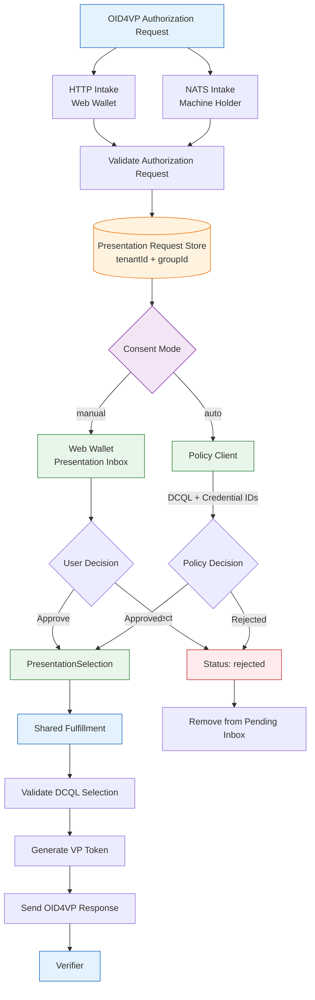

## 1. Authorization Request Intake

### HTTP Intake — Human Holder

The Web Wallet submits a complete OID4VP authorization URL via HTTP. The service validates the request and stores it with `consentMode=manual`.

The HTTP API follows the microservice routing convention:

```http
POST /v1/{tenantId}/api/presentation/presentations
```

The surrounding infrastructure supplies the context through the route and headers (`x-tenantid`, `x-groupid`, `x-namespace`, `x-group`, and optionally `x-host`). The tenant ID in the route and header must agree when both are supplied.

### NATS Intake — Machine Holder

A machine agent submits an OID4VP authorization URL through a NATS CloudEvent, using the event type `verifier.presentation.authorization.remote` on the `presentation.authorisation` subject. The request is validated and stored with `consentMode=auto`.

The transport does not inherently determine consent: a trusted caller explicitly assigns `manual` or `auto` at intake. Both transports use the same request-processing core.

## 2. Presentation Request Storage

Validated requests are stored in Cassandra, isolated by `tenantId` and `groupId`.

| Field | Description |
|---|---|
| `presentationId` | Internal request identifier |
| `tenantId` | Tenant identifier |
| `groupId` | Holder account identifier |
| `namespace` | Cryptographic key namespace |
| `group` | Cryptographic key group |
| `consentMode` | Immutable `manual` or `auto` |
| `status` | Processing status |
| `dcqlQuery` | Requested credentials and claims |
| `clientId` | Verified verifier identifier |
| `expiresAt` | Request expiration time |

Supported statuses: `pending`, `processing`, `completed`, `rejected`, `failed`, and `blocked`.

Rejected requests are **not deleted immediately**. They are marked `rejected` and removed from the pending inbox. Cassandra TTL handles eventual removal. Status changes must preserve the remaining TTL.

## 3. Manual Consent — Human Holder

Requests with `consentMode=manual` appear in the Web Wallet's presentation inbox, scoped to the current `tenantId` and `groupId`.

The holder can:

1. View pending presentation requests and the verifier identity.
2. Inspect DCQL requirements and matching credential candidates.
3. Select credentials and permitted claim disclosures.
4. Approve or reject a request.
5. Block unwanted verifiers.

**Approve:** The wallet submits a `PresentationSelection`. The service validates it against the stored request before fulfillment.

**Reject:** The service atomically changes the status to `rejected`. The request disappears from the pending inbox and cannot subsequently be approved.

## 4. Automatic Consent — Machine Holder

Requests with `consentMode=auto` are evaluated without human interaction:

1. Retrieve matching credentials from Credential Storage.
2. Send the original DCQL query, matching credential IDs, and holder/verifier context to the external Policy Client.
3. Receive an approved `PresentationSelection` or a denial.
4. Validate the returned selection against the original DCQL query and holder scope.
5. Fulfill approved requests; mark denied requests as `rejected`.

The **Policy Client decides consent**. The Holder Service does not implement a separate policy engine.

Flow: 
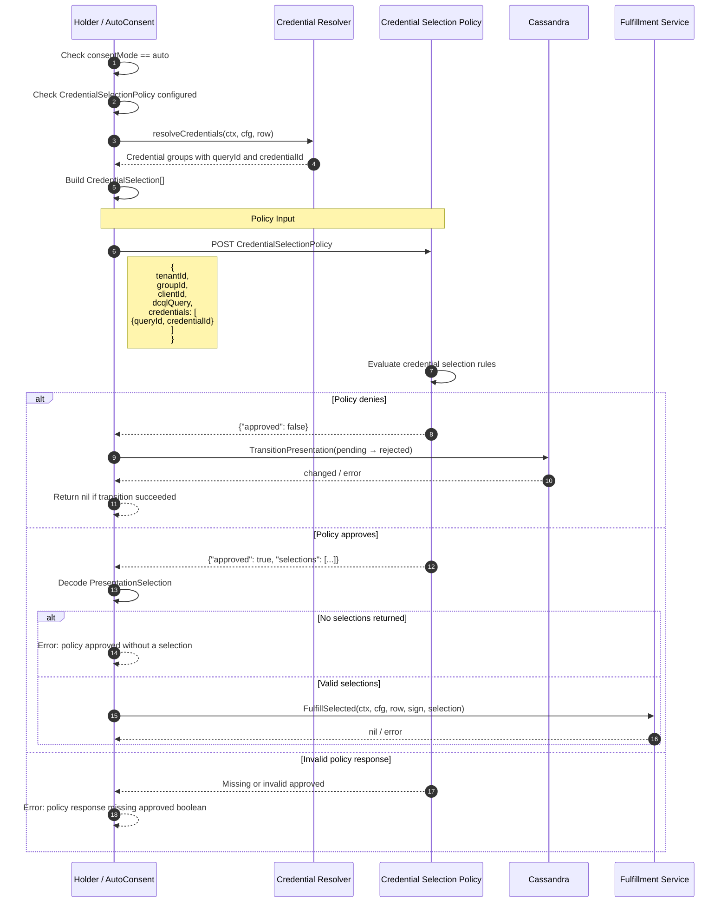

Policy Input: 

```json
{
  "tenantId": "demo-tenant",
  "groupId": "demo-group",
  "clientId": "https://verifier.example.org",
  "dcqlQuery": {
    "credentials": [
      {
        "id": "identity",
        "format": "dc+sd-jwt"
      }
    ]
  },
  "credentials": [
    {
      "queryId": "identity",
      "credentialId": "credential-123"
    },
    {
      "queryId": "identity",
      "credentialId": "credential-456"
    }
  ]
}
```

Policy Output with Approve: 
```json
{
  "approved": true,
  "selections": [
    {
      "queryId": "identity",
      "credentialId": "credential-123"
    }
  ]
}
```

Policy Output without Approve:

```json
{
  "approved": false
}
```


## 5. PresentationSelection

Both consent modes produce the same structure:

```json
{
  "presentationId": "presentation-123",
  "approved": true,
  "selections": [
    {
      "queryId": "identity",
      "credentialId": "credential-123",
      "claimIds": ["given_name", "family_name"]
    }
  ]
}
```

| Field | Description |
|---|---|
| `presentationId` | Stored authorization request |
| `approved` | Consent decision |
| `queryId` | DCQL credential query identifier |
| `credentialId` | Selected credential from storage |
| `claimIds` | Selected DCQL claim identifiers, when applicable |

Selections must satisfy DCQL credential queries, `credential_sets`, claim constraints, and `claim_sets`. The service must not silently disclose claims that were not selected.

## 6. Shared Presentation Fulfillment

```text
PresentationSelection
        |
        v
Load Stored Authorization Request
        |
        v
Validate Selection against DCQL
        |
        v
Load Selected Credentials
        |
        v
Generate VP Token / Required Proofs
        |
        v
Build OID4VP Authorization Response
        |
        v
Send Response to Verifier
```

The service constructs the response according to the authorization request, including `direct_post` and, where applicable, encrypted `direct_post.jwt`. DCQL-based OID4VP responses use `vp_token` rather than `presentation_submission`.

## 7. Holder Context and Isolation

| Parameter | Purpose | HTTP source |
|---|---|---|
| `tenantId` | Tenant isolation | `/v1/{tenantId}` and `x-tenantid` |
| `groupId` | Holder account isolation | `x-groupid` |
| `namespace` | Crypto Provider key namespace | `x-namespace` |
| `group` | Crypto Provider key group | `x-group` |
| `host` | Original host, where needed | `x-host` |

The context is supplied by trusted XFSC infrastructure. The Holder Service does **not** implement its own authentication or account management. The gateway must overwrite untrusted client-provided context headers, and direct public access to the service must be restricted. NATS publishers must likewise be authorized to assert their supplied context.

The complete context is persisted at intake and reused for fulfillment. `groupId` (holder account) and `group` (key group) are distinct values.

## 8. Security and Lifecycle Rules

- Consent mode and holder context are immutable after intake.
- Manual requests are decided through the Web Wallet; automatic requests through the Policy Client.
- Credential selections must satisfy the stored DCQL request and holder ownership constraints.
- Presentation requests are fulfilled at most once, using atomic status transitions.
- Rejected and blocked requests cannot later be approved.
- Blocking a verifier prevents new actionable requests and closes pending ones in the same holder scope.
- Expiration is enforced from the authorization request and stored `expiresAt`; Cassandra TTL handles retention.
- Cryptographic proof generation uses the stored `namespace` and `group` rather than assuming they equal `tenantId` and `groupId`.

## 9. Design Principles

**Transport independence:** HTTP and NATS share one request-processing core.

**Consent separation:** The Web Wallet manages human consent; the external Policy Client decides machine consent.

**Immutable context:** Consent mode and holder context are fixed at request creation.

**Shared fulfillment:** Both approved flows use the same DCQL validation, credential loading, proof generation, and OID4VP response pipeline.


---

# End-to-end OID4VP operator guide (manual and machine consent)

This section documents the **actual routes and JSON fields in this revision**. All examples assume a trusted gateway has authenticated the caller and supplied the required holder context. Replace the example hosts, tenant, account and key identifiers.

## A. Verifier: create a VP authorization and obtain a wallet link

### A1. NATS verifier request/reply (recommended for service-to-service integrations)

Configure the verifier's `presentationRequest` NATS subject. Publish a CloudEvent with type `verifier.presentation.authorization` and the following `data` object (the transport uses the configured subject, not necessarily the event type as the subject):

```json
{
  "specversion": "1.0",
  "id": "request-event-1",
  "source": "vp-integration",
  "type": "verifier.presentation.authorization",
  "datacontenttype": "application/json",
  "data": {
    "tenantId": "demo-tenant",
    "groupId": "demo-account",
    "requestId": "vp-demo-001",
    "dcql_query": {
      "credentials": [{
        "id": "identity",
        "format": "dc+sd-jwt",
        "meta": {"vct_values": ["https://issuer.example/types/identity"]},
        "claims": [{"path": ["test"]}]
      }]
    },
    "client_id": "decentralized_identifier:did:web:verifier.example",
    "ttl": 3600,
    "tenant_uri": "verifier.example",
    "target_uri": "wallet.example",
    "requestobject_uri": "verifier.example"
  }
}
```

Use a NATS **request/reply** client. The reply event data contains `presentation_id` (opaque state) and `request_uri` (complete authorization URL). Forward the **complete** `request_uri` string to the wallet/holder; do not construct it from the opaque state yourself. The verifier serves the signed Request Object at `/presentation/proof/{state}/request-object/request.jwt`, and receives `direct_post` at `/presentation/proof/{state}` (with the gateway's configured version/tenant prefix).

**Important:** `client_id` must resolve to the verifier's actual DID signing identity; `target_uri` is the wallet host and `requestobject_uri` the externally reachable verifier host. The Request Object endpoint in this version advertises `response_mode=direct_post` (not `direct_post.jwt`). For `ldp_vc`, replace the DCQL format and credential constraints with an LDP VC query supported by the deployed DCQL library.

### A2. HTTP verifier request creation (alternative)

The existing `GET /presentation/request` endpoint accepts the DCQL query as **base64url without padding** in `dcqlQuery`, plus `requestId` query parameter and `x-tenantId`, `x-groupId`, `x-client-id` (or `x-did`) and optional `x-ttl` headers. It creates the verifier transaction and returns a signed Request Object. The NATS method above is preferable when you need the complete authorization URL and presentation ID in one response.

## B. Manual holder: resolve a received VP link and approve it

**Step 1 — Submit the complete OID4VP link** returned by the verifier or received via QR code. The holder fetches `request_uri`, validates the Request Object, stores the DCQL snapshot, and creates a pending manual transaction:

```bash
BASE="https://holder.example/v1/tenants/demo-tenant/api/presentation"
AUTH_URL='openid4vp://authorize?client_id=decentralized_identifier%3Adid%3Aweb%3Averifier.example&request_uri=https%3A%2F%2Fverifier.example%2Fpresentation%2Fproof%2FSTATE%2Frequest-object%2Frequest.jwt'

curl -fsS -X POST "$BASE/presentations" \
  -H 'Content-Type: application/json' \
  -H 'x-tenantid: demo-tenant' \
  -H 'x-groupid: demo-account' \
  -H 'x-namespace: crypto-namespace' \
  -H 'x-group: crypto-group' \
  --data "$(jq -n --arg url "$AUTH_URL" '{url:$url,consentMode:"manual",ttl:3600}')"
```

Response: `201 {"presentationId":"<opaque-state>","status":"pending"}`. Keep this `presentationId` unchanged.

**Step 2 — List pending requests** (same headers):

```bash
curl -fsS "$BASE/presentations" \
  -H 'x-tenantid: demo-tenant' -H 'x-groupid: demo-account' \
  -H 'x-namespace: crypto-namespace' -H 'x-group: crypto-group'
```

**Step 3 — Inspect one request and matching credentials**:

```bash
PID='<presentationId-from-step-1>'
curl -fsS "$BASE/presentations/$PID" \
  -H 'x-tenantid: demo-tenant' -H 'x-groupid: demo-account' \
  -H 'x-namespace: crypto-namespace' -H 'x-group: crypto-group'
curl -fsS "$BASE/presentations/$PID/candidates" \
  -H 'x-tenantid: demo-tenant' -H 'x-groupid: demo-account' \
  -H 'x-namespace: crypto-namespace' -H 'x-group: crypto-group'
```

The candidates response contains `dcqlQuery` and `candidates`. Select **actual** `queryId` and `credentialId` values from that response; do not invent credential IDs.

**Step 4 — Approve and transmit**:

```bash
curl -fsS -X POST "$BASE/presentations/$PID/approve" \
  -H 'Content-Type: application/json' \
  -H 'x-tenantid: demo-tenant' -H 'x-groupid: demo-account' \
  -H 'x-namespace: crypto-namespace' -H 'x-group: crypto-group' \
  -d '{
    "holderDid":"did:web:holder.example",
    "signKey":"holder-key",
    "selections":[{
      "queryId":"identity",
      "credentialId":"ACTUAL_CREDENTIAL_ID_FROM_CANDIDATES",
      "disclosures":["test"]
    }]
  }'
```

For **SD-JWT**, `disclosures` contains the selected top-level claim names (for example `test`), which the signer maps to its disclosure frame. Required DCQL claims must actually be disclosed. For **LDP VC**, omit `disclosures`; the selected credential is embedded in the JSON-LD Verifiable Presentation and signed by the crypto-provider. `claimIds` is currently **not** supported and is rejected; do not send it.

Response on success: `200 {"status":"completed"}`. The service signs and sends the VP to the verifier's `response_uri`; **do not POST the VP manually after approval**. To reject instead, `POST "$BASE/presentations/$PID/reject"` with the same gateway headers (returns HTTP 204).

## C. Machine holder: resolve the same VP link with automatic consent

Set `externalPresentation.credentialSelectionPolicy` to your reachable policy HTTP endpoint. Send a NATS request to the holder's configured `authorization` subject. The CloudEvent **type** is `verifier.presentation.authorization.remote`; the **data** must contain:

```json
{
  "specversion": "1.0",
  "id": "machine-request-event-1",
  "source": "vp-machine-client",
  "type": "verifier.presentation.authorization.remote",
  "datacontenttype": "application/json",
  "data": {
    "tenantId": "demo-tenant",
    "groupId": "demo-account",
    "requestId": "machine-vp-001",
    "url": "openid4vp://authorize?client_id=decentralized_identifier%3Adid%3Aweb%3Averifier.example&request_uri=https%3A%2F%2Fverifier.example%2Fpresentation%2Fproof%2FSTATE%2Frequest-object%2Frequest.jwt",
    "consentMode": "auto",
    "ttl": 3600,
    "did": "did:web:holder.example",
    "key": "holder-key",
    "namespace": "crypto-namespace",
    "group": "crypto-group"
  }
}
```

The holder resolves the Request Object, retrieves credential candidates and POSTs to the configured policy endpoint:

```json
{
  "tenantId":"demo-tenant",
  "groupId":"demo-account",
  "clientId":"decentralized_identifier:did:web:verifier.example",
  "dcqlQuery":{"credentials":[{"id":"identity","format":"dc+sd-jwt","claims":[{"path":["test"]}]}]},
  "credentials":[{"queryId":"identity","credentialId":"ACTUAL_CREDENTIAL_ID"}]
}
```

The policy must return an explicit decision and a credential selection. For an SD-JWT claim `test`:

```json
{
  "approved":true,
  "selections":[{
    "queryId":"identity",
    "credentialId":"ACTUAL_CREDENTIAL_ID",
    "disclosures":["test"]
  }]
}
```

For LDP VC omit `disclosures`. To deny return `{"approved":false}`. A positive decision without selections is rejected. The NATS reply CloudEvent data contains `presentation_id`, `status` (`completed`, `pending`, or `failed`) and optional `error`. The machine holder sends the VP to the verifier automatically after approval; no manual `/approve` call is needed.

## D. Response modes, verifier requirements and deployment notes

- Holder **outgoing** responses support `direct_post` and encrypted `direct_post.jwt` for both SD-JWT and LDP VC, depending on the incoming Request Object. For encrypted responses, the verifier must supply a compatible ECDH-ES P-256 JWK and encryption metadata.
- This service's own **incoming verifier** endpoint currently advertises and accepts `direct_post` only. Incoming `direct_post.jwt` requires provisioning and publishing a verifier encryption keypair and implementing JWE decryption; it is intentionally rejected rather than silently treated as a missing token.
- The verifier cryptographically validates both formats using `SignerService.PresentationVerifyUrl`; for SD-JWT it also validates the disclosed credential against DCQL. If the crypto-provider does not return `disclosedCredential`, the verifier reconstructs top-level disclosures from the already-verified compact SD-JWT and checks their digests. Nested disclosure matching is not supported by this fallback.
- Ensure the crypto-provider verifies issuer signatures, SD-JWT `sd_hash`, KB-JWT signature and holder binding, expected `nonce` and `aud`. A successful HTTP 200 alone is **not** sufficient; it must return `{"valid":true}` and perform those checks.
- The trusted gateway must authenticate and authorize the holder headers. The service does not treat caller-supplied headers as proof of identity.
- Legacy `POST /internal/proofs/proof/{state}/fulfill` has been **removed**. Migrate callers to the manual Holder API or the machine NATS request/reply flow.
