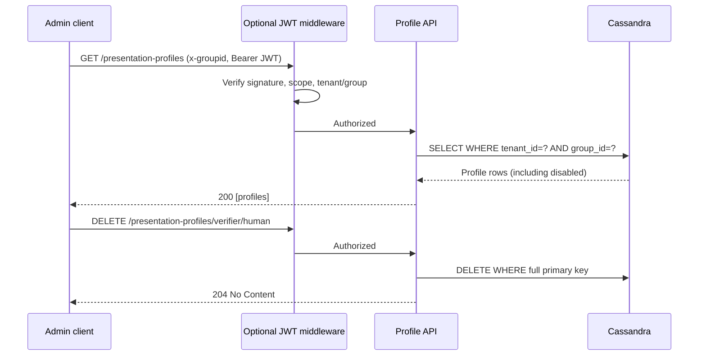

# OID4VP Presentation Profiles

All tenant/group OID4VP configuration is stored in `ocm.presentation_profiles` (migration V006). The single Cassandra row for `(tenant_id,group_id,profile_type,interaction_type)` contains signing identifiers and, for verifier rows, a map from **permission set** to serialized DCQL JSON. There is no presentation-policy HTTP service.

## Create a verifier profile

`PUT /v1/tenants/{tenantId}/internal/presentation-profiles/verifier/human` with trusted `x-groupid` header and JSON:

```json
{
  "enabled": true,
  "did": "did:web:tenant.example.org",
  "origin": "https://tenant.example.org",
  "keyNamespace": "tenant_space",
  "keyId": "eckey",
  "signingAlgorithm": "ES256",
  "responseMode": "direct_post",
  "requestObjectTtlSeconds": 300,
  "presentationPolicies": {
    "mitgliedschaft": "{\"credentials\":[{\"id\":\"membership\",\"format\":\"dc+sd-jwt\",\"meta\":{\"vct_values\":[\"https://example.org/MembershipCredential\"]}}]}"
  }
}
```

The profile UUID is generated on first creation. The PUT route is internal and **must be protected by the trusted gateway**. Never expose this administrative route to arbitrary callers.

## Authorization

HTTP: `POST /v1/tenants/{tenantId}/internal/presentations/authorization`, `x-groupid: ...`, body `{ "permissionSet": "mitgliedschaft" }` selects `verifier/human`.

NATS: CloudEvent `verifier.presentation.authorization` with `tenant_id`, `group_id`, `request_id`, `permission_set` selects `verifier/machine`.

The profile DID determines `decentralized_identifier:<DID>`; origin determines the request URI; signing key and namespace are snapshotted in the presentation row. The DCQL is snapshotted in that row as well. No profile or permission set fallback occurs.

## Holder

Create `holder/human` or `holder/machine` with the same API. `requestObjectPolicyUrl` and `credentialSelectionPolicyUrl` belong to holder profiles. The fixed holder authorization path is `/api/holder/authorize` and is not stored in Cassandra. Gateway routing must expose this path.

## Local development

Run `docker compose -f deployment/docker/docker-compose.yml up -d --build`. Cassandra migrations create the table automatically. Create profiles using the internal API before invoking the authorization scripts. `scripts/verifier-http-create.sh mitgliedschaft` and `scripts/verifier-nats-create.sh mitgliedschaft` no longer accept policy IDs, DID or origin. Set `TENANT_ID` and `GROUP_ID` as needed.

## Security and migration

The trusted gateway must authenticate and authorize the caller for tenant/group/permission-set; transport alone does not authenticate NATS messages. Existing presentation-policy HTTP configuration is removed. Old transactions without a signing-key snapshot cannot be served as signed request objects and must be recreated. A rollout requires provisioning profiles before issuing new authorizations.


## Complete profile management API (October 2026)

All endpoints are under `/v1/tenants/{tenantId}/internal/presentation-profiles` and require the `x-groupid` header. The JWT middleware, if enabled through `CREDENTIALVERIFICATION_PROFILE_ADMIN_JWKS_URL`, applies to **all** methods and checks token signature, expiry, tenant, group and configured scope (`presentation-profiles:write` by default). These are internal administrative endpoints, not public APIs.

| Method | Path suffix | Result |
|---|---|---|
| `GET` | `/` | `200` JSON array of profiles for tenant/group, including disabled; empty array if none |
| `GET` | `/{profileType}/{interactionType}` | `200` JSON profile, or `404` |
| `PUT` | `/{profileType}/{interactionType}` | `200` JSON profile (create/update; preserves existing UUID and creation timestamp) |
| `DELETE` | `/{profileType}/{interactionType}` | `204` no content; idempotent |

`profileType` must be `verifier` or `holder`; `interactionType` must be `human` or `machine`. The URL and trusted `x-groupid` determine the profile key; do not rely on tenant/group/type fields supplied in the JSON body. Cassandra uses `PRIMARY KEY ((tenant_id,group_id),profile_type,interaction_type)`. Listing reads one partition only; deletion targets one full primary key. A deleted profile is not recoverable through the API; disabling via PUT is preferable when retaining configuration matters. Deleting an active profile can interrupt new authorizations; existing authorization state should be treated separately.



### CLI smoke tests

```bash
export BASE_URL=http://localhost:8080 TENANT_ID=demo_tenant GROUP_ID=group1
export JWT="<access-token>" # omit only when JWT protection is disabled
./scripts/profiles/list-profiles.sh
export PROFILE_TYPE=verifier INTERACTION_TYPE=human
./scripts/profiles/get-profile.sh
./scripts/profiles/delete-profile.sh
./scripts/profiles/list-profiles.sh
```

The scripts use `curl -f` and exit nonzero for HTTP 4xx/5xx. **Security:** Without a configured JWKS URL, all administrative endpoints are unauthenticated at the application layer; restrict them at the ingress/network layer. Always configure issuer and audience in production. Authorization requests must not infer access rights merely from the existence of a permission set.
