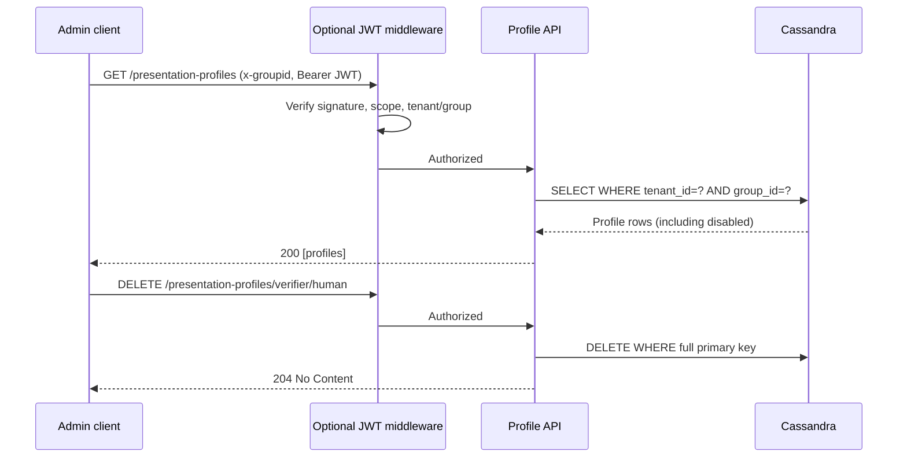

# Profile administration JWT protection

The existing `PUT /v1/tenants/{tenantId}/internal/presentation-profiles/{profileType}/{interactionType}` creates **or updates** a profile. The existing `GET` reads it. An update preserves `profileId` and `createdAt` when the existing profile can be loaded. Administrative reads include disabled profiles, so updates preserve their existing UUID and creation timestamp. Runtime authorization reads still reject disabled profiles.

Only these two management routes are protected by the optional JWT middleware. Authorization routes are unchanged.

Configure `CREDENTIALVERIFICATION_PROFILE_ADMIN_JWKS_URL` (HTTPS URL) to enable JWT validation; leave empty to disable. Optional `CREDENTIALVERIFICATION_PROFILE_ADMIN_ISSUER` and `CREDENTIALVERIFICATION_PROFILE_ADMIN_AUDIENCE` enforce JWT `iss` and `aud` claims. Production should configure both. Helm: `profileAdminAuth.jwksUrl`, `profileAdminAuth.issuer`, `profileAdminAuth.audience`.

Requests must provide `Authorization: Bearer <JWT>` and `x-groupid: <group>`. JWT claims `tenant_id` and `group_id` must exactly equal the route `tenantId` and `x-groupid`. Signature is validated against JWKS by `kid`, with supported asymmetric algorithms; expiration is required. Missing/mismatched claims fail closed. JWKS is cached for up to five minutes; a refresh failure returns HTTP 503. Key rotation can therefore take up to five minutes to propagate. Use a trusted JWKS endpoint and restrict outbound network access to it.

The middleware also requires the OAuth scope `presentation-profiles:write` (configurable through `CREDENTIALVERIFICATION_PROFILE_ADMIN_SCOPE` / Helm `profileAdminAuth.scope`) in the `scope` claim (space-delimited) or `scp` claim (array). Configure issuer and audience and restrict the internal gateway. Without JWKS configuration, all admin routes remain unprotected by this middleware.


## Complete profile management API (October 2026)

All endpoints are under `/v1/tenants/{tenantId}/internal/presentation-profiles` and require the `x-groupid` header. The JWT middleware, if enabled through `CREDENTIALVERIFICATION_PROFILE_ADMIN_JWKS_URL`, applies to **all** methods and checks token signature, expiry, tenant, group and configured scope (`presentation-profiles:write` by default). These are internal administrative endpoints, not public APIs.

| Method | Path suffix | Result |
|---|---|---|
| `GET` | `/` | `200` JSON array of profiles for tenant/group, including disabled; empty array if none |
| `GET` | `/{profileType}/{interactionType}` | `200` JSON profile, or `404` |
| `PUT` | `/{profileType}/{interactionType}` | `200` JSON profile (create/update; preserves existing UUID and creation timestamp) |
| `DELETE` | `/{profileType}/{interactionType}` | `204` no content; idempotent |

`profileType` must be `verifier` or `holder`; `interactionType` must be `human` or `machine`. The URL and trusted `x-groupid` determine the profile key; do not rely on tenant/group/type fields supplied in the JSON body. Cassandra uses `PRIMARY KEY ((tenant_id,group_id),profile_type,interaction_type)`. Listing reads one partition only; deletion targets one full primary key. A deleted profile is not recoverable through the API; disabling via PUT is preferable when retaining configuration matters. Deleting an active profile can interrupt new authorizations; existing authorization state should be treated separately.



### CLI smoke tests

```bash
export BASE_URL=http://localhost:8080 TENANT_ID=demo_tenant GROUP_ID=group1
export JWT="<access-token>" # omit only when JWT protection is disabled
./scripts/profiles/list-profiles.sh
export PROFILE_TYPE=verifier INTERACTION_TYPE=human
./scripts/profiles/get-profile.sh
./scripts/profiles/delete-profile.sh
./scripts/profiles/list-profiles.sh
```

The scripts use `curl -f` and exit nonzero for HTTP 4xx/5xx. **Security:** Without a configured JWKS URL, all administrative endpoints are unauthenticated at the application layer; restrict them at the ingress/network layer. Always configure issuer and audience in production. Authorization requests must not infer access rights merely from the existence of a permission set.
