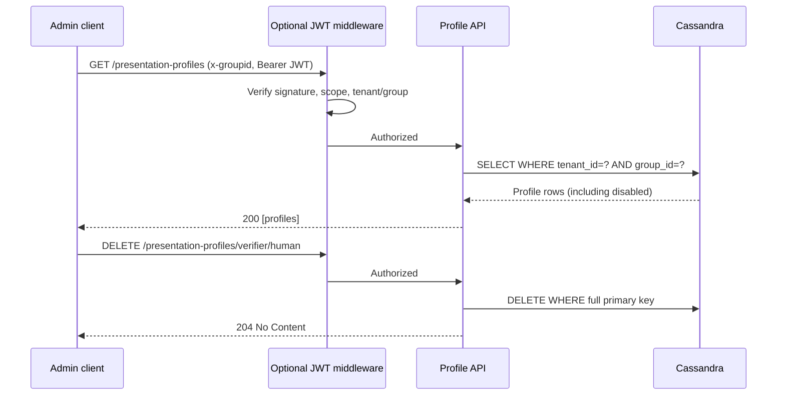

# Profile administration scripts

The implemented routes are **GET** and **PUT** (upsert); DELETE and list are not implemented.

```bash
export BASE_URL=http://localhost:8080
export TENANT_ID=demo_tenant GROUP_ID=group1
export PROFILE_TYPE=verifier INTERACTION_TYPE=human
export PROFILE_FILE=scripts/profiles/examples/verifier-human.json
# With JWKS enabled, set JWT to a token with tenant_id, group_id and presentation-profiles:write scope.
./scripts/profiles/upsert-profile.sh
./scripts/profiles/get-profile.sh
```

For machine verifier use `INTERACTION_TYPE=machine` and `PROFILE_FILE=scripts/profiles/examples/verifier-machine.json`.
For holder use `PROFILE_TYPE=holder` and `PROFILE_FILE=scripts/profiles/examples/holder-human.json`.


## Complete profile management API (October 2026)

All endpoints are under `/v1/tenants/{tenantId}/internal/presentation-profiles` and require the `x-groupid` header. The JWT middleware, if enabled through `CREDENTIALVERIFICATION_PROFILE_ADMIN_JWKS_URL`, applies to **all** methods and checks token signature, expiry, tenant, group and configured scope (`presentation-profiles:write` by default). These are internal administrative endpoints, not public APIs.

| Method | Path suffix | Result |
|---|---|---|
| `GET` | `/` | `200` JSON array of profiles for tenant/group, including disabled; empty array if none |
| `GET` | `/{profileType}/{interactionType}` | `200` JSON profile, or `404` |
| `PUT` | `/{profileType}/{interactionType}` | `200` JSON profile (create/update; preserves existing UUID and creation timestamp) |
| `DELETE` | `/{profileType}/{interactionType}` | `204` no content; idempotent |

`profileType` must be `verifier` or `holder`; `interactionType` must be `human` or `machine`. The URL and trusted `x-groupid` determine the profile key; do not rely on tenant/group/type fields supplied in the JSON body. Cassandra uses `PRIMARY KEY ((tenant_id,group_id),profile_type,interaction_type)`. Listing reads one partition only; deletion targets one full primary key. A deleted profile is not recoverable through the API; disabling via PUT is preferable when retaining configuration matters. Deleting an active profile can interrupt new authorizations; existing authorization state should be treated separately.



### CLI smoke tests

```bash
export BASE_URL=http://localhost:8080 TENANT_ID=demo_tenant GROUP_ID=group1
export JWT="<access-token>" # omit only when JWT protection is disabled
./scripts/profiles/list-profiles.sh
export PROFILE_TYPE=verifier INTERACTION_TYPE=human
./scripts/profiles/get-profile.sh
./scripts/profiles/delete-profile.sh
./scripts/profiles/list-profiles.sh
```

The scripts use `curl -f` and exit nonzero for HTTP 4xx/5xx. **Security:** Without a configured JWKS URL, all administrative endpoints are unauthenticated at the application layer; restrict them at the ingress/network layer. Always configure issuer and audience in production. Authorization requests must not infer access rights merely from the existence of a permission set.
